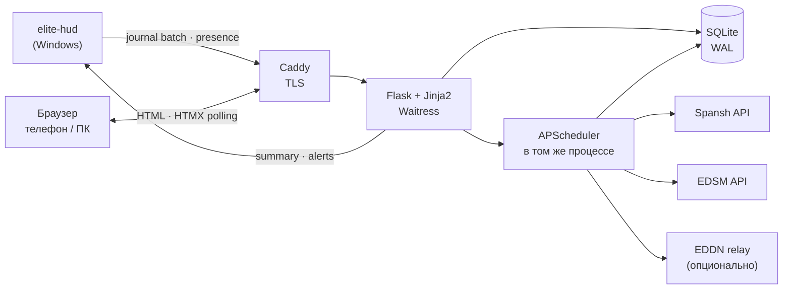

# KSSN Hub — штаб эскадрильи Korolev Star Syndicate

> Статус: в реализации, версия 0.7 · 22.10.2026  
> Домен: `kssn.space` · Связанный продукт: `elite-hud`  
> Документ описывает продукт, архитектуру, данные и этапы реализации.  
> Код: [kssn-hub](../kssn-hub/README.md) — этапы 1–3 и плейбуки этапа 4.  
> В 0.2 добавлены стартовые системы, экономика и торговые точки, лёгкий стек без
> Redis/PostgreSQL/Docker. В 0.3 начата реализация; в 0.4 добавлена сверка
> станций Spansh + EDSM; в 0.5 — фракции, состояния, конфликты, импорт журналов
> и страница «Обстановка»; в 0.6 — device-токены, приём журналов HUD, presence и
> рыночные снимки; в 0.7 — стартовые плейбуки, советы в карточке системы и
> редактор с версиями.

---

## 0. Коротко

**KSSN Hub** — приватный веб-штаб эскадрильи на `kssn.space`. Он собирает в одном
месте то, что сейчас разбросано по игре, EDSM, Spansh, Inara, Discord и чужим
гайдам, и отвечает на три вопроса:

1. **Что происходит** в наших системах?
2. **Что это значит** для эскадрильи и конкретной фракции?
3. **Что делать сейчас** — что везти, какие миссии брать, куда лететь, чего избегать?

`elite-hud` остаётся окном в игру, но становится ещё и датчиком: при посещении
отмеченных систем отправляет в штаб разрешённые события журнала и получает обратно
короткую сводку — обстановку, рекомендацию и прогресс операций.

**Чем это не является:** это не замена Inara, не трекер всей галактики, не
автоматизация игры и не публичный сайт с личными данными. Это узкий инструмент
под конкретную эскадрилью и наши 8–20 систем.

**Что в v1.0:** каталог систем и фракций, экономика каждой системы отдельно от
торговых точек, крупные космопорты и наземные порты, состояния и конфликты с
объяснениями, рынки и «что везти», приём журналов с HUD, присутствие пилотов,
операции штаба и обратная сводка в HUD.

**Стек — лёгкий:** Python, Flask, SQLite, Jinja2 + HTMX, один процесс и одна
база-файл. Без Redis, PostgreSQL, Node, React и Docker. Это осознанный выбор под
20–50 пилотов, а не «на вырост».

---

## 1. Задача и принципы

### 1.1. Что болит сейчас

| Проблема | Как выглядит на практике |
|---|---|
| Данные разбросаны | Цены — на Inara, трафик — на EDSM, система и станции — на Spansh, состояние — в журнале, миссии — в чате Discord |
| Нет ответа «что делать» | Состояние `Outbreak` видно, но что везти, на какую станцию и какими миссиями лечить — надо знать BGS или искать гайд |
| Рынок устаревает | Цена на Inara была час назад, а спрос уже выбран; непонятно, можно ли на неё опираться |
| Нет истории | Влияние фракции и конфликт видно только на момент визита; непонятно, растём мы или падаем |
| Нет координации | Кто сейчас онлайн, кто что взял, кто куда летит — только по сообщениям в чате |
| Свои системы не выделены | Инструменты показывают всю галактику, а нам нужны наши системы и наши цели |
| Экономика системы смешана с экономикой станции | Непонятно, что именно означает «экономика системы» и куда лететь: крупный космопорт, наземный порт, аутпост или носитель |
| HUD показывает, но не спрашивает | Журнал читается локально и никуда не уходит; веб-сервис не знает, что видел пилот |

### 1.2. Продуктовая формулировка

> **KSSN Hub — это оперативный штаб эскадрильи: он превращает сырые данные о
> системах, фракциях, рынках и трафике в понятную картину и конкретные действия,
> а HUD доставляет эту картину в игру и приносит из игры свежие факты.**

### 1.3. Принципы

1. **Ответ, а не дамп.** Любая страница заканчивается действием: что везти, куда
   лететь, какую миссию взять, чего не делать.
2. **Честная свежесть.** У каждого числа есть источник и возраст. Старое
   показывается как старое, неизвестное — как неизвестное, а не как ноль.
3. **Приватность по умолчанию.** HUD отправляет только разрешённые события и
   только из отмеченных систем. Личные финансы, штрафы и розыск не уходят.
4. **HUD не мешает игре.** Сеть, очередь и ошибки штаба не блокируют оверлей и не
   роняют игру. Нет связи — тихо копим и показываем статус.
5. **Сначала читать, потом писать.** Сначала — достоверная картина и приём
   журналов. Редактирование, заявки и сложные сценарии — постепенно.
6. **Всё прослеживается.** Рекомендация объясняет, из каких фактов, правил и
   источников она получилась.
7. **Маленький сервис, который можно починить одному.** Один VDS, один процесс,
   SQLite, Flask и чистый HTML; без Redis, PostgreSQL, Node и Docker.

### 1.4. Границы проекта

| Не делаем в v1 | Почему |
|---|---|
| Замену Inara / EDSM / Spansh | Мы их агрегируем и дополняем, а не повторяем |
| Данные по всей галактике | Ценность — в наших системах и наших целях |
| Публичный профиль пилота с его местоположением | Это личные данные; по умолчанию только эскадрилья |
| Автоматизацию игры: чтение памяти, управление клиентом, CAPI без разрешения | Вне правил Frontier и вне задачи |
| Аукцион и торговлю между игроками | В v1 только контракты носителей и логистические заявки |
| Полноценный BGS-симулятор | Мы даём рекомендации и объяснения, а не гарантированный прогноз |
| Мобильное приложение | Адаптивная веб-версия закрывает сценарий |
| LLM, который сам придумывает советы | Сначала — проверенные людьми плейбуки; «объяснить проще» можно позже |
| Замену Discord | В v1 веб + HUD; уведомления в Discord — отдельным этапом |
| SPA, микросервисы, Redis/PostgreSQL «на вырост» | Нагрузка маленькая; сложность должна быть ниже, чем у игры |

---

## 2. Пользователи и роли

| Роль | Кто это | Что может | Чего не может |
|---|---|---|---|
| **Владелец / админ** | Командир эскадрильи | Всё: пользователи, устройства, системы, источники, плейбуки, аудит, настройки | — |
| **Офицер** | 1–3 доверенных командира | Создавать и вести операции, редактировать черновики плейбуков, добавлять системы, писать заметки, подтверждать данные | Менять владельца, удалять аудит, выдавать админку |
| **Член эскадрильи** | Пилот с доступом | Смотреть штаб, делиться журналом и миссиями, брать задачи, создавать свои операции | Менять чужие операции, плейбуки, системы |
| **Кандидат / гость** | Проверяемый пилот | Ограниченный просмотр: свои системы, общие операции, без личных данных других | Видеть присутствие, журналы и личные миссии |
| **HUD (устройство)** | `elite-hud` на компьютере пилота | Отправлять журналы, рынок, присутствие; получать сводку | Читать чужие данные, менять что-либо в штабе |
| **Публичный посетитель** | Случайный гость `kssn.space` | Только лендинг и, возможно, агрегированная сводка без личных данных | Всё остальное |

Права проверяются на сервере, а не в интерфейсе. У устройства есть свои scopes:
`ingest:journal`, `ingest:market`, `presence`, `summary`. Токен можно отозвать в
любой момент.

---

## 3. Сценарии

### 3.1. Перед сессией

Пилот открывает `kssn.space` с телефона или второго экрана. Видит:

* **На связи:** 3 пилота, двое в нашей home-системе, один везёт груз.
* **Требует внимания:** в соседней системе `Outbreak`, в home-системе второй день
  `War`, у носителя через 40 минут прыжок.
* **Что везти:** 3 рекомендации с товаром, станцией, ценой, спросом и расстоянием.
* **Операции:** «Щит дома» — 4/12 задач, дедлайн послезавтра.

Пилот решает, куда лететь, ещё до запуска игры.

### 3.2. Прибытие в отмеченную систему

HUD видит `FSDJump`, отправляет событие в штаб. Штаб обновляет систему, фракции,
конфликты и трафик. На следующий запрос сводки HUD получает:

> `[⚑] KSSN · Wregoe NK-E c25-13: эпидемия · везти Advanced Medicines на KSSN HQ · 2 онлайн`

Пилот открывает систему в штабе, видит карточку состояния, список товаров, миссий
и объяснение, почему это важно.

### 3.3. Офицер планирует операцию

Офицер создаёт операцию «Поднять `Korolev Star Syndicate` до 60% в home-системе»,
добавляет задачи: торговля, миссии, bounties, контроль конфликта. Назначает
ответственных и дедлайн. Штаб сам считает прогресс по тем событиям, которые
разрешили присылать пилоты, и показывает, где мы отстаём.

### 3.4. Рынок и «что везти»

Пилот открывает `Outbreak`-систему. Штаб показывает:

* экономику системы и спрос на `Advanced Medicines` и `Basic Medicines` по
  торговым точкам — крупным космопортам и наземным портам отдельно;
* где рядом есть запас и по какой цене;
* какие миссии `Mission_Altruism_Outbreak` и курьерские `Outbreak` сейчас бывают;
* что `bounty vouchers` это состояние не лечат;
* насколько свежи данные и стоит ли им верить.

### 3.5. Данные устарели

В системе нет свежего рынка: последний снимок 3 дня назад. Штаб не строит по нему
маршрут, а пишет: «нужен визит, данные 3 дня назад» и предлагает задачу
«разведка рынка». Если рядом есть пилот — показывает его.

### 3.6. HUD офлайн

Связи нет. HUD складывает события в локальную очередь, играет дальше. При
восстановлении связи отправляет накопленное без дублей. В оверлее — маленький
индикатор «штаб: офлайн», который не отвлекает.

---

## 4. Информационная архитектура

### 4.1. Страницы

| Путь | Назначение | Главный вопрос |
|---|---|---|
| `/` | Штаб «Сейчас» | Что происходит и что делать? |
| `/systems` | Список наших систем | Где всё спокойно, а где горит? Какая экономика и сколько торговых точек? |
| `/systems/{id64}` | Карточка системы | Что тут за фракции, рынок, трафик и конфликты? |
| `/states` | Состояния фракций | Что значит это состояние и чем помочь? |
| `/situation` | Обстановка | Кто с кем, состояние, день, за что; факт или предположение |
| `/markets` | Торговые точки, рынки и товары | Где купить, где продать, что везти? |
| `/markets/{marketId}` | Рынок станции | Что есть на станции и когда обновлялось? |
| `/trade` | Маршруты и контракты | Какая поездка окупится и поможет фракции? |
| `/ops` | Операции эскадрильи | Кто что делает и успеваем ли? |
| `/fleet` | Флотоносцы | Где носители, сколько груза, какие ордера? |
| `/playbooks` | Плейбуки | Почему мы советуем именно это? |
| `/me` | Профиль и приватность | Что я отдаю, какие устройства, как удалить? |
| `/admin` | Админка | Пользователи, системы, источники, аудит |

### 4.2. Главная «Сейчас»

Шесть блоков, каждый — со ссылкой на подробности:

1. **На связи.** Пилоты эскадрильи, последний раз видели, система, корабль,
   режим игры. Только для тех, кто разрешил присутствие.
2. **Требует внимания.** Война, эпидемия, голод, lockdown, приближающийся прыжок
   носителя, просроченная задача, устаревшие данные в важной системе.
3. **Наши системы.** Таблица: экономика, состояние, конфликт, трафик, число
   крупных космопортов и наземных портов, свежесть, число пилотов, ближайшее
   действие.
4. **Что везти.** 3–5 рекомендаций: товар, станция назначения, цена, спрос,
   расстояние, откуда взять, свежесть данных.
5. **Флот.** Носители: позывной, система, груз/вместимость, прыжок, доступ.
6. **Операции.** Активные операции, прогресс, ближайший дедлайн.

### 4.3. Карточка системы

Вкладки:

| Вкладка | Содержимое |
|---|---|
| **Обзор** | Принадлежность, правительство, безопасность, население, **экономика системы (primary/secondary + доли)**, роль эскадрильи, контролирующая фракция и сила, число тел, трафик, носители, свежесть |
| **Фракции** | Влияние, состояния, pending/recovering, счастье, конфликты, «наша / дружественная / цель», история влияния |
| **Торговля** | **Крупные космопорты**, **наземные порты**, прочие точки; услуги и чёрный рынок, товары, buy/sell, спрос/запас, возраст цены, `ls` до станции, лучшие сделки, история |
| **Трафик** | EDSM за сутки/неделю/всего, разбивка по кораблям, присутствие эскадрильи, число носителей по снимкам |
| **Носители** | Носители в системе: свои и чужие, расстояние, услуги, ордера |
| **История** | Снимки системы: влияние, состояния, конфликты, цены, трафик |
| **Заметки** | Заметки офицеров, цели, задачи, «что здесь делать» |

**Малые фракции (minor factions).** В карточке видны все фракции, присутствующие
в системе, а не только правящая: влияние, состояние, правительство,
принадлежность, счастье и конфликты. Каждой можно поставить метку «наша»,
«дружественная», «цель» или «противник» и привязать к ней цель операции. Именно
из этих меток штаб понимает, чьи состояния и конфликты важны, а какие можно
игнорировать.

**Экономика системы и торговые точки — два разных уровня.** Их нельзя смешивать:

* **Экономика системы** — `primaryEconomy` / `secondaryEconomy` и доли экономик из
  журнала или Spansh, плюс роль, которую задал админ: «штаб», «добыча»,
  «переработка», «сельхоз», «военка». Показывается отдельным блоком вверху
  карточки системы.
* **Торговые точки** — станции, где есть рынок и куда имеет смысл лететь:
  * **Крупные орбитальные** — Dodec / Orbis / Ocellus / Coriolis / Starport с
    большими площадками и рынком;
  * **Крупные наземные** — `Planetary Port` с рынком;
  * **Наземные аутпосты** — `Planetary Outpost` / `CraterOutpost`;
  * **Поселения** — `Odyssey Settlement` / `Planetary Settlement`;
  * **Прочие торговые точки** — orbital Outpost, Megaship;
  * **Не торговые точки** — Space Construction Depot, Planetary Construction
    Depot, System Colonisation Ship, Fleet Carrier. Рынок у них может быть, но для
    BGS-торговли они не равны станции: выносим их в блоки «Стройка» и «Носители».

`StationType` приходит в разных написаниях: `PlanetaryOutpost` в журнале,
`Planetary Outpost` в Spansh, `CraterOutpost` в `Docked`, иногда `null` в EDSM.
Нормализуем к одному словарю. `port_class` — грубый бакет для БД и старых
запросов, `port_subclass` — точная истина для интерфейса. Поле `isPlanetary` у
Spansh иногда `null`, поэтому наземность определяем по типу и имени, а не по
одному флагу.

| `StationType` (примеры) | `port_class` | `port_subclass` | В торговые точки |
|---|---|---|---|
| Dodec / Orbis / Ocellus / Coriolis / Starport | `large_orbital` | `large_orbital` | Да, если есть рынок |
| Planetary Port | `planetary` | `planetary_port` | Да, крупный наземный |
| Planetary Outpost, CraterOutpost | `planetary` | `planetary_outpost` | Да |
| Odyssey Settlement, Planetary Settlement | `planetary` | `settlement` | Да |
| Outpost | `outpost` | `orbital_outpost` | Да, в «прочие» |
| Megaship | `megaship` | `megaship` | Да, в «прочие» |
| Space Construction Depot | `construction` | `construction_orbital` | Нет |
| Planetary Construction Depot | `construction` | `construction_planetary` | Нет |
| System Colonisation Ship | `construction` | `construction_orbital` | Нет; имя важнее типа Spansh |
| Fleet Carrier, Drake-Class Carrier | `carrier` | `carrier` | Нет |
| неизвестный тип | `outpost` (бакет) | `unknown` | Нет, пока не проверен |

Подписи в UI: «Крупный космопорт», «Крупный наземный порт», «Наземный аутпост»,
«Поселение», «Орбитальный аутпост», «Мегашип», «Стройка», «Носитель», «Неизвестно».

Пример карточки:

```text
Wregoe NK-E c25-13 · Штаб-квартира · High
Экономика: Agriculture + Extraction
Крупные орбитальные (1)
  Korolev Star Syndicate Headquarters · Dodec · 5 L · 3247.7 ls
Крупные наземные (0)
Наземные аутпосты (2)
  Chernenko's Deposit · 58 ls
  Ozarkevich Legacy · 39 ls
Поселения (3)
Стройка: 6 орбитальных + 15 наземных
```

```text
Wregoe FB-H b51-3 · Услуги · Low
Экономика: Service + Tourism
Крупные орбитальные
  нет
Крупные наземные
  нет
Наземные аутпосты (1)
  Picard's Folly · Planetary Outpost · 21 935 ls
Прочие: Sherstobitov Legacy · Outpost · 8.7 ls
```

В системе есть и орбитальная стройплощадка `Picard's Folly`, и наземный аутпост
`Picard's Folly`. Это разные станции; в карточке у каждой видны тип, источник и
`ls`, поэтому они не сливаются в одну.

21 935 ls — это не «рядом»: в рекомендации учитываем и `ly` между системами, и
`ls` от звезды до станции.

### 4.4. Карточка состояния или конфликта

Главный элемент продукта. Она отвечает не «что», а «что с этим делать»:

* **Что происходит.** `Outbreak` у фракции X, спрос на лекарства вырос.
* **Почему это важно.** Если не лечить — состояние затягивается, влияние падает.
* **Что делать.** Везти `Advanced Medicines` и `Basic Medicines` на станцию Y;
  брать миссии `Mission_Altruism_Outbreak` и курьерские `Outbreak`.
* **Что не помогает.** `bounty vouchers` состояние не лечат.
* **Где взять.** Ближайшие станции с запасом, расстояние, цена, свежесть.
* **Кто участвует.** Фракции, их влияние, дни конфликта, stake.
* **Риски и оговорки.** «Данные рынка 6 часов; проверьте спрос в игре».
* **Обратная связь.** «Помогло / не помогло» — чтобы офицеры правили плейбук.

### 4.5. Рынки и контракты

* **Обозреватель товаров:** фильтры по системе, станции, товару, цене, спросу,
  запасу, размеру площадки, возрасту данных.
* **Торговые точки:** группировка «крупные космопорты / наземные порты / прочие»;
  фильтр по `ls`, площадке, наличию рынка и услуг. Строительные площадки и
  носители в этот список не попадают.
* **Услуги точки:** рынок, чёрный рынок, верфь, аутфиттинг. Если источник не
  сообщает услугу, пишем «неизвестно», а не «нет»: чёрный рынок может быть скрыт
  от публичных снимков.
* **Лучшая продажа** среди наших систем: максимум `buyPrice` при ненулевом спросе
  и свежих данных.
* **Лучшая закупка:** минимум `sellPrice` при ненулевом запасе.
* **Маршрут:** одна посадка в v1, несколько — позже. Прибыль, расстояние в `ly`,
  `ls` до станции, время, размер площадки, риск.
* **Контракты носителей:** `CarrierTradeOrder` — что носитель покупает или
  продаёт, по какой цене и сколько.
* **Торговые миссии:** `Mission_Delivery`, `Mission_Collect`, `Mission_Mining` и
  другие — из журнала, с привязкой к операции и станцией назначения.
* **Логистические заявки:** «нужно 500 т `Advanced Medicines` на носитель» —
  внутренняя координация, не аукцион.
* **История цен:** график по станции и товару, чтобы видеть тренд, а не одну точку.

### 4.6. Операции

Операция — это цель, задачи, ответственные и срок. Типы:

| Тип | Пример | Как считается прогресс |
|---|---|---|
| **BGS** | Поднять влияние фракции до 60% | Снимки влияния + отметки офицера |
| **Торговля** | Завезти 5000 т лекарств | `MarketSell` / `MarketBuy` / ручная отметка |
| **Миссии** | Выполнить 20 миссий `Outbreak` | `MissionCompleted` с привязкой к операции |
| **Бой** | Победить в конфликте | `RedeemVoucher` / ручная отметка |
| **Логистика** | Загрузить носитель | `CarrierStats` / `CargoTransfer` / ручная отметка |
| **Разведка** | Проверить рынок и состояние | `Docked` + `Market` в системе |
| **Своя** | Любая цель | Ручной прогресс |

Статусы: `draft`, `active`, `paused`, `done`, `failed`. Все изменения — в аудите.

### 4.7. Флот

* Свои носители: позывной, имя, владелец, система, стыковка, груз, вместимость,
  резерв, топливо, доступ, услуги, текущий прыжок и время.
* Публичные носители в наших системах — отдельно, с пометкой «не наш».
* Ордера: что покупает/продаёт носитель, цена, количество.
* История перемещений: кто куда прыгал и когда.
* «Трафик носителей» — число носителей в системе по снимкам, а не онлайн.

### 4.8. Наши системы (стартовый список)

Список из восьми систем плюс военная, название которой уточняется. Ниже —
данные после сверки **Spansh + EDSM** на 21.10.2026. EDSM добавил наземные порты и
поселения, которых Spansh не отдал; стройплощадки двух источников местами
различаются, поэтому каждая станция хранит список источников и флаг «проверить».
**Роль из списка и фактическая экономика хранятся отдельно:** роль — это план
эскадрильи, экономика — то, что игра показывает сейчас. В карточке системы видны
оба поля, чтобы не выдавать план за факт. Роль — короткий тег (`hq`, `mining`,
`refinery`, `industrial`, `high_tech`, `agriculture`, `services`, `military`,
`mixed`) плюс свободная заметка `role_note`.

| # | Система | id64 | Роль из списка | Экономика системы (факт) | Контроль |
|---|---|---|---|---|---|
| 1 | Wregoe NK-E c25-13 | 3657802191578 | Штаб-квартира; широкая экономика | Agriculture + Extraction | Ancient Legio 70.4% |
| 2 | Wregoe DG-H b51-3 | 7272319231417 | Добыча ископаемых | Extraction + Industrial | Traders & Explorers Inc. 61.3% |
| 3 | Wregoe DG-H b51-4 | 9471342486969 | Переработка | Refinery + Industrial | T&E 70.0%, в состоянии War |
| 4 | Wregoe DG-H b51-6 | 13869388998073 | Промышленность | Industrial + Extraction | T&E 71.1%, Boom |
| 5 | Wregoe DG-H b51-5 | 11670365742521 | Высокие технологии | High Tech + Extraction | T&E 49.3% (War), Ancient Legio 39.8% (Expansion) |
| 6 | Wregoe NK-E c25-33 | 9155360330458 | Сельскохозяйственная | **Industrial + Refinery** | Ancient Legio 46.2% (War), T&E 46.2% (War) |
| 7 | Wregoe FB-H b51-3 | 7272319165881 | Услуги; чёрный рынок | Service + Tourism | T&E 61.9%, Ancient Legio 19.4% (Expansion) |
| 8 | Wregoe EB-H b51-8 | 18267167008185 | Добыча + высокие технологии | **Military + Colony** | T&E 60.0%, Baya Imperial Society 20.0% |
| 9 | Военная система | уточняется | Военная | — | — |

**Торговые точки по этим системам:**

| Система | Крупные орбитальные | Крупные наземные | Наземные аутпосты | Поселения | Прочее |
|---|---|---|---|---|---|
| Wregoe NK-E c25-13 | **Korolev Star Syndicate Headquarters** — Dodec, 5 L, 3247.7 ls | — | **Chernenko's Deposit** — 58 ls; **Ozarkevich Legacy** — 39 ls | 3 поселения | 1 носитель, 6 орбитальных + 15 наземных стройплощадок |
| Wregoe DG-H b51-3 | **Korolev Star Syndicate Mining Corporation** — Coriolis, 5 L, 234.9 ls | — | — | **Lukashenko Mining Territory** — 234 ls | 3 орбитальных + 3 наземных стройплощадки |
| Wregoe DG-H b51-4 | **Korolev Star Syndicate Metals Corporation** — Dodec, 5 L, 1414.7 ls | **Drumars Legacy** — Planetary Port, 4667 ls | — | **Dzsejt Mining Territory** — 4654 ls | 4 носителя, 1 орбитальная + 17 наземных стройплощадок |
| Wregoe DG-H b51-6 | **Korolev Star Syndicate Industrial Center** — Coriolis, 7 L, 583.7 ls | — | — | — | 1 орбитальная + 3 наземных стройплощадки |
| Wregoe DG-H b51-5 | **Korolev Star Syndicate Research Center** — Coriolis, 7 L, 244.0 ls | — | — | **Omenuko Astrophysics Assembly** — 244 ls | 6 орбитальных + 1 наземная стройплощадка |
| Wregoe NK-E c25-33 | **Korolev Star Syndicate Agricultural Complex** — Coriolis, 8 L, 2765.7 ls | — | — | — | 1 носитель, 3 орбитальных + 5 наземных стройплощадок |
| Wregoe FB-H b51-3 | — | — | **Picard's Folly** — Planetary Outpost, 21 935 ls | — | Sherstobitov Legacy — орбитальный аутпост, 8.7 ls; 2 орбитальные стройплощадки |
| Wregoe EB-H b51-8 | — | — | — | — | 5 орбитальных стройплощадок (Spansh; EDSM пуст, нужно подтверждение) |

**Что важно в этих данных:**

* **Spansh один не годится для портов.** EDSM дал в c25-13 два наземных аутпоста
  (`Chernenko's Deposit`, `Ozarkevich Legacy`) и три поселения, а в b51-4 —
  крупный наземный порт `Drumars Legacy`. В исходном снимке Spansh их не было.
* **`Picard's Folly` — это наземный `Planetary Outpost`.** В системе есть ещё
  орбитальная стройплощадка с тем же именем; в карточке у обеих показан тип,
  источник и `ls`, чтобы их не путать.
* **`System Colonisation Ship` Spansh помечает как `Planetary Outpost`.** Наша
  классификация ставит имя выше типа для строительных объектов и определяет его
  как орбитальную стройку, а не как наземный порт.
* **Штаб-квартира — «широкая» станция.** Система числится
  `Agriculture + Extraction`, но у Dodec-станции семь экономик: Agriculture 700,
  Extraction 160, Industrial 15, Military 15, High Tech 10, Refinery 10,
  Terraforming 100 (веса Spansh). «Широкая экономика» — свойство станции.
* **Сельхоз-система c25-33 сейчас `Industrial + Refinery`.** Станция называется
  `Agricultural Complex`, но её фактическая экономика — Refinery с долей
  Agriculture 25. Роль «сельскохозяйственная» оставляем как план, факт показываем
  отдельно.
* **EB-H b51-8 по Spansh — `Military + Colony`, EDSM не отдаёт ни одной станции.**
  В базе только стройплощадки Spansh, все помечены «проверить». Роль «добыча +
  high tech» — план; нужен визит HUD.
* **Стройплощадки быстро меняются.** Spansh и EDSM называют разные площадки;
  поэтому мы не удаляем станцию, если её нет во втором источнике, а помечаем
  `needs_review` и показываем список источников.
* **Источник и возраст видны у каждой станции.** `journal` важнее EDSM, EDSM
  важнее Spansh; при расхождении типов ставится `confidence=conflict`.

Этот список становится seed-данными для этапа 2: `name`, `id64`, `role`, а
экономика и порты подтягиваются из Spansh/EDSM и уточняются журналом.

---

## 5. Данные: источники, свежесть, честность

### 5.1. Матрица источников

| Домен | Основной источник | Дополнительно | Частота | Честная оговорка |
|---|---|---|---|---|
| Система: координаты, тела, экономика | Spansh (`/api/dump/{id64}`) | EDSM system | При добавлении, далее раз в сутки | У Spansh нет публичной стабильной спецификации; API может меняться |
| Полный список станций | Журнал `Docked`/`Location`, EDSM stations | Spansh dump | При стыковке / раз в сутки | Spansh **неполный**: часть наземных портов и поселений есть только в EDSM |
| Экономика системы | Журнал `FSDJump`/`Location` → `SystemEconomy`, `SystemSecondEconomy` | Spansh dump, EDSM system | При визите / раз в сутки | Роль эскадрильи и фактическая экономика — разные поля |
| Экономика станции | Журнал `Docked` → `StationEconomies[].Proportion` | Spansh `economies`, EDSM `economy` | При стыковке / раз в сутки | В Spansh веса могут суммироваться не в 100; нормализуем |
| Торговые точки: тип, услуги, `ls` | Журнал `Docked` → `StationType`, `StationServices`, `DistFromStarLS` | EDSM stations, Spansh dump | При стыковке / раз в сутки | `type` в EDSM бывает `null`; `isPlanetary` у Spansh бывает `null`; классифицируем по типу и имени |
| Фракции: влияние, состояния | Журнал `FSDJump`/`Location` | Spansh dump, EDSM factions, локальный импорт журналов | При визите / синхронизация | Влияние меняется тиком; источники расходятся — показываем `sources` и `confidence=conflict` |
| Конфликты | Журнал `FSDJump`/`Location` → `Conflicts[]` | EDDN journal (позже) | При визите / импорт | EDSM и Spansh не отдают `Conflicts`; если два `War`/`CivilWar`, показываем «предположительно» |
| Рынок: цена, спрос, запас | `Market.json` от HUD | EDDN commodity, Spansh dump | При стыковке; иначе из EDDN/Spansh | Цена — на момент снимка, а не «сейчас» |
| Трафик игроков | EDSM traffic | — | Раз в час / по запросу | Это посещения за сутки/неделю/всего, не онлайн |
| Носители в системе | EDSM stations, Spansh | Журнал `CarrierJump` | Раз в час / при визите | Снимок, а не список в реальном времени |
| Свои носители: груз, ордера | HUD `CarrierStats`, `CarrierTradeOrder`, `Market` | — | По событию | Только если владелец разрешил |
| Присутствие эскадрильи | HUD heartbeat | — | 60 секунд | Только свои; публичного «онлайна» в игре нет |
| Миссии и операции | HUD `MissionAccepted`/`Completed` | Ручное создание | По событию | Личные миссии — только по согласию |
| Заметки, цели, плейбуки | Офицеры | — | Вручную | Человеческое знание, не API |

Экономики приходят в разных видах: `$economy_Industrial;` в журнале, `Industrial` в
Spansh, `Agriculture` в EDSM. Нормализуем к одному словарю: `Agriculture`,
`Extraction`, `Refinery`, `Industrial`, `High Tech`, `Military`, `Service`,
`Tourism`, `Colony`, `Terraforming`, `None`. Доли экономик храним как числа и
нормализуем к процентам для отображения, потому что веса Spansh не всегда дают в
сумме 100.

### 5.2. Модель свежести

Каждый факт хранит:

* `source` — `journal`, `hud`, `eddn`, `spansh`, `edsm`, `manual`, `legacy`;
* `observed_at` — когда факт наблюдался в игре;
* `received_at` — когда мы его получили;
* `confidence` — `high`, `medium`, `low`, `conflict`, `unknown`.

| Метка | Возраст | Как используется |
|---|---|---|
| **live** | до 5 минут | Можно строить рекомендацию |
| **recent** | до 24 часов | Можно, но с указанием возраста |
| **stale** | больше 24 часов | Показываем, но не строим маршрут и не обещаем прибыль |
| **unknown** | нет данных | Честно пишем «нет данных», предлагаем разведку |

Правила слияния:

1. Новое не перезаписывается старым: сравниваем `observed_at`, а не порядок
   прихода.
2. Источники не смешиваются в одно число: храним строки по источникам, а
   витрина выбирает лучший по приоритету, который зависит от домена. Станции:
   `journal > edsm > spansh`; фракции: `journal > edsm > spansh`; рынок:
   `hud > eddn > spansh`; экономика: `hud > spansh > edsm`.
3. Даты вне окна `[сейчас − 7 дней; сейчас + 1 час]` считаются неизвестными.
   Отдельно отбрасываем «даты-заглушки» вроде `2198-09-24` из Spansh.
4. Если данные противоречат — показываем оба источника и расхождение, а не
   выбираем молча.
5. Для станций источник не перезаписывает другой: каждая версия лежит в
   `station_observations`, а `stations` — это слияние по приоритету
   `journal > edsm > spansh > legacy`.
6. Если станция есть только в одном источнике, она **не удаляется**: получает
   `needs_review=1`, `confidence=low` и остаётся видимой с пометкой.
7. Если источники дают разные `port_subclass`, ставится `confidence=conflict` и
   `needs_review=1`; администратор видит расхождение на `/admin/data`.

### 5.3. Чего публичные API не умеют

| Вопрос | Честный ответ | Что показываем |
|---|---|---|
| Кто сейчас в системе? | Публичного API нет | Только присутствие эскадрильи по HUD |
| Сколько игроков онлайн? | Ни EDSM, ни Spansh этого не дают | «Трафик за сутки/неделю» с подписью, что это посещения |
| Сколько флотоносцев сейчас? | Только снимок на момент обновления | Число носителей и возраст снимка |
| Какая экономика у системы? | Spansh/EDSM могут отставать; журнал точнее | Факт, дата, источник и отдельно роль |
| Где крупный космопорт, а где наземный порт? | Тип станции из Spansh/EDSM/журнала; `isPlanetary` бывает null | Группы, тип и `body` |
| Какой сейчас конфликт? | Только журнал/EDDN | Подтверждённый конфликт; иначе «предположительно» из состояний War/CivilWar |
| Точная цена прямо сейчас? | Только если кто-то открыл рынок | Цена с временем и источником |
| Какие миссии на станции? | Публичного API нет | Ожидаемые типы миссий + реальные, которыми поделились пилоты |
| Онлайн флотоносцев? | Не существует | Прыжки и стоянки по журналам |

Это не ограничения нашей реализации, а свойства данных. Штаб должен говорить об
этом прямо, иначе он будет выглядеть увереннее, чем есть.

### 5.4. Сверка станций

Одного Spansh недостаточно: в `Wregoe NK-E c25-13` он не отдал два наземных
аутпоста и три поселения, а в `Wregoe DG-H b51-4` — крупный наземный порт
`Drumars Legacy`. Поэтому станции собираются из трёх источников:

1. **Журнал HUD** — `Docked` / `Location` / `CarrierJump`: `StationType`,
   `BodyType`, `StationServices`, `StationEconomies`, `DistFromStarLS`.
2. **EDSM stations** — полный список, включая поселения и наземные порты;
   `type` иногда `null`, зато есть `body` и `updateTime`.
3. **Spansh dump** — полезен для орбитальных станций, но неполный по поверхности.

Каждая версия пишется в `station_observations` с `source`, `observed_at` и
`raw`. Слияние в `stations` идёт по приоритету `journal > edsm > spansh > legacy`:

* `port_class` — грубый бакет для старых запросов;
* `port_subclass` — точный тип (`large_orbital`, `planetary_port`,
  `planetary_outpost`, `settlement`, `orbital_outpost`, `megaship`,
  `construction_orbital`, `construction_planetary`, `carrier`, `unknown`);
* `sources` — какие источники видели станцию;
* `needs_review` — нет подтверждения или источники расходятся;
* `confidence` — `high` (журнал), `medium` (EDSM), `low` (только Spansh) или
  `conflict`.

Правила классификации:

* известный `type` важнее имени;
* **имя важнее типа для строительных объектов**: Spansh помечает
  `System Colonisation Ship` как `Planetary Outpost`, но это орбитальная стройка;
* `Planetary Construction Site` — наземная стройка, `Orbital Construction Site` —
  орбитальная;
* неизвестный тип не угадывается: `port_subclass=unknown`, `needs_review=1`,
  станция не попадает в торговые точки;
* `Planetary Port` и `Planetary Outpost` — разные группы, а не один «наземный
  порт».

Администратор видит всё это на **`/admin/data`**: конфликты, станции без
подтверждения, распределение по типам и источникам, кнопки «Обновить Spansh +
EDSM», «EDSM: станции» и «Переклассифицировать».

### 5.5. Фракции, состояния и конфликты

Фракции собираются по той же схеме, что и станции: `faction_observations`
хранит снимок каждого источника, `faction_presence` — слияние по приоритету
`journal > edsm > spansh`.

* **Журнал** (`FSDJump`/`Location`) даёт `Factions[]`, влияние, состояния,
  счастье и `Conflicts[]`; это самый точный источник.
* **EDSM** даёт фракции, влияние и состояния, но не конфликты.
* **Spansh dump** даёт фракции и состояния, но не конфликты и не все наземные
  станции.
* Если источники расходятся по состоянию, ставится `confidence=conflict` и
  `needs_review=1`; влияние показывается из источника с высшим приоритетом.
* **Конфликт из журнала** — единственный «настоящий»: он содержит `WarType`,
  `Status`, `Stake` и `WonDays`. Если журнала нет, но два фракции в системе
  находятся в `War`/`CivilWar`, создаётся строка `source=inferred`,
  `status=inferred`: это подсказка, а не факт, и дни/stake не выдумываются.
* Журнальный конфликт вытесняет предположение для той же пары; устаревшее
  предположение удаляется, когда состояния перестают быть конфликтными.

**Импорт существующих журналов.** `flask import-journal-dir --path ../-journal`
разбирает только `FSDJump`/`Location`/`CarrierJump` в наблюдаемых системах и
сохраняет фракции, состояния и конфликты. Это не заменяет этап 3: живой приём
журналов от HUD появится отдельно, с device token и очередью.

**Обстановка.** Страница `/situation` построена вокруг систем: одна карточка на
систему, главный блок — `Traders & Explorers Inc.` (влияние, состояния,
конфликты), остальные фракции — в раскрывающемся справочнике без состояний.
Рекомендации и плейбуки применяются только к нашей фракции; в карточке системы
есть блоки «Конфликты», «Фракции и состояния» и «Что делать».

---

## 6. Архитектура

### 6.1. Компоненты

| Компонент | Технология | Задача |
|---|---|---|
| **Web** | Flask 3 + Jinja2 | Страницы, API, cookie-сессии, CSRF |
| **WSGI-сервер** | Waitress | Один процесс, несколько потоков, без async-сложности |
| **Frontend** | HTMX + vanilla JS + один CSS | Серверный HTML, точечные обновления, без Node и SPA |
| **БД** | SQLite 3 (WAL) | Системы, экономика, торговые точки, рынки, журналы, операции |
| **Фоновые задачи** | APScheduler в том же процессе (опционально, `KSSN_SCHEDULER=1`) | Ставит системы в очередь и обрабатывает `refresh_queue`; в тестах и локально выключен |
| **Очередь** | таблица `refresh_queue` в SQLite | Durable-задачи без Redis; ручной `refresh-queue` и фоновый обработчик |
| **Reverse proxy** | Caddy 2 (опционально) | TLS для `kssn.space`, HTTP/2, заголовки безопасности |
| **EDDN consumer** | отдельный процесс (опционально) | Живой рынок и журналы, если понадобится |
| **Мониторинг** | `/healthz` + Uptime Kuma | Доступность, диск, ошибки |
| **Бэкапы** | `sqlite3 .backup` + `restic` | Восстановление на новом VDS |

### 6.2. Схема



### 6.3. Потоки данных

**Приём журнала.**

1. HUD отправляет батч событий с токеном устройства и `Idempotency-Key`.
2. Flask проверяет токен, scopes, размер, времена, список разрешённых событий.
3. Дубликаты отсекаются по хешу события.
4. Сырое событие пишется в `journal_events` в одной короткой транзакции.
5. Быстрые проекции обновляются сразу: система, экономика, станция, присутствие,
   носитель.
6. Если данных системы не хватает, в `refresh_queue` добавляется задача (с
   дедупликацией по системе) — без ожидания сети в ответе HUD.

**Обогащение.**

1. APScheduler раз в 30 секунд берёт пачку задач из `refresh_queue`.
2. Проверяет возраст данных и пропускает свежие.
3. Тянет Spansh/EDSM с таймаутом, кэшем и backoff.
4. Нормализует экономику, доли, типы портов и пишет строки с `source`,
   `observed_at`, `received_at`.
5. Пересчитывает снимок системы и алерты.
6. Сбрасывает кэш сводки; страницы подхватывают изменения следующим HTMX-опросом.

**Страницы.**

1. Jinja2 рендерит HTML на сервере.
2. HTMX обновляет блоки «Сейчас», «Требуется внимание» и «Что везти» раз в
   30 секунд, без WebSocket и SSE.
3. Графики — серверный inline SVG, без Chart.js и клиентской сборки.

**Рекомендация.**

1. Берём активные состояния/конфликты целевой фракции.
2. Выбираем плейбук по приоритету.
3. Для каждого действия ищем товары на **торговых точках** (`large_orbital`,
   `planetary`, при их отсутствии — `outpost`), спрос, запас, `ly` и `ls`.
4. Отбрасываем stale-цены, строительные площадки и носители как цель BGS-торговли.
5. Ранжируем по влиянию, прибыли, риску и расстоянию.
6. Сохраняем объяснение: какие факты и правила использованы.

### 6.4. Почему такой стек

* **Python + Flask** — тот же язык, что у HUD; синхронный, простой, без async-БД.
  Для одного разработчика это важнее «модности».
* **SQLite** — одна база-файл, WAL, нормальная работа при 20–50 пилотах. Проще
  бэкап, проще восстановление, нечего администрировать. JSON храним как TEXT,
  поиск — через FTS5.
* **Jinja2 + HTMX + один CSS** — серверный рендеринг без SPA-сборки, Node и
  клиентского состояния. HTMX — один локальный файл, без CDN; графики — inline
  SVG. Точечные обновления вместо WebSocket.
* **APScheduler + `refresh_queue`** — фоновые задачи без Redis, Celery и отдельного
  worker-процесса. Задача переживает перезапуск, потому что лежит в таблице.
* **Waitress + systemd + Caddy** — одно приложение, автозапуск и TLS без Docker.
* **Caddy** — автоматический TLS и короткий конфиг; без него можно начать с
  nginx, но Caddy проще.

**Зависимости.** Flask, Waitress, APScheduler, pytest. Всё остальное — stdlib:
`sqlite3`, `gzip`, `hashlib`, `hmac`, `urllib`, `json`, `secrets`. Никаких
ORM, Redis-клиентов, Celery и Node-сборки.

**Граница лёгкости.** SQLite сериализует записи. Для 50 пилотов, батчей раз в
15 секунд и фоновых снимков этого достаточно; `busy_timeout` и короткие
транзакции обязательны. Если когда-нибудь появится больше нагрузки, слой
репозиториев позволит перейти на PostgreSQL, но в v1 это не нужно.

### 6.5. VDS и деплой

| Параметр | Значение |
|---|---|
| Минимум | 1 vCPU, 2 ГБ RAM, 40 ГБ SSD, Ubuntu 24.04 LTS |
| Комфортно | 2 vCPU, 4 ГБ RAM, 60 ГБ SSD (если включаем EDDN и много систем) |
| Процесс | Один `waitress` + APScheduler-поток; память ~150–300 МБ |
| Сеть | 80/443 наружу; 22 — только по ключу и с ограничением по IP, если возможно |
| DNS | `A`/`AAAA` для `kssn.space`, `www` → редирект, опционально `status.kssn.space` |
| TLS | Caddy, автоматическое продление, HSTS |
| Обновления | unattended-upgrades; `systemctl restart kssn-hub` после деплоя |
| Бэкапы | ежедневно `sqlite3 hub.db ".backup …"` + `restic` в S3/B2, шифрование, 30 дней |
| Восстановление | проверка раз в месяц на чистой БД; цель RTO ≤ 2 ч, RPO ≤ 24 ч |
| CI/CD | GitHub Actions (pytest) → SSH deploy: `git pull`, `pip install`, restart; миграции через `PRAGMA user_version` |
| Мониторинг | `/healthz`, Uptime Kuma снаружи, алерт на диск > 80% |
| Стоимость | ориентировочно €5–10/мес за VDS и бэкапы, без учёта домена |

Почему не Docker, PostgreSQL и Redis: нагрузка предсказуемо маленькая, а
сложность эксплуатации должна быть ниже, чем у самой игры. Docker полезен, когда
сервисов много; здесь сервис один, и `systemd` + venv даёт тот же результат с
меньшим числом движущихся частей.

---

## 7. Модель данных

### 7.1. Основные таблицы

| Группа | Таблица | Ключевые поля |
|---|---|---|
| Доступ | `users` | `id`, `callsign`, `password_hash`, `role`, `totp_secret`, `session_version`, `created_at` |
| Доступ | `invites` | `code_hash`, `role`, `expires_at`, `used_by` |
| Доступ | `devices` | `id`, `user_id`, `name`, `token_hash`, `scopes`, `last_seen`, `revoked_at` |
| Галактика | `systems` | `id64` PK, `name`, `coords`, `allegiance`, `government`, `security`, `population`, **`primary_economy`**, **`secondary_economy`**, **`economy_shares`** (TEXT JSON), **`role`**, **`role_note`**, `controlling_faction_id`, `controlling_power`, `power_state`, `is_watched`, `tags`, `notes` |
| Галактика | `stations` | `market_id` PK, `system_id64`, `name`, `type`, `type_normalized`, **`port_class`**, **`port_subclass`**, `is_planetary`, `has_market`, `body_name`, `distance_to_arrival`, `pad_large/medium/small`, `services` (TEXT JSON), `primary_economy`, `secondary_economy`, `economies` (TEXT JSON), `is_carrier`, **`sources`** (TEXT JSON), **`needs_review`**, **`confidence`**, `source`, `observed_at`, `updated_at` |
| Галактика | `station_observations` | `market_id`, `system_id64`, `source`, `name`, `type`, `port_class`, `port_subclass`, `is_planetary`, `has_market`, `body_name`, `distance_to_arrival`, pads, `services`, `economies`, `observed_at`, `fetched_at`, `raw` (TEXT JSON); PK `(market_id, source)` |
| Галактика | `factions` | `id` PK, `name` UNIQUE, `government`, `allegiance`, `home_system_id64`, `is_player`, `updated_at` |
| Галактика | `faction_observations` | `system_id64`, `faction_name`, `source`, `government`, `allegiance`, `influence`, `state`, `happiness`, `active_states`, `pending_states`, `recovering_states`, `is_player`, `observed_at`, `fetched_at`, `raw`; PK `(system_id64, faction_name, source)` |
| Галактика | `faction_presence` | `system_id64`, `faction_id`, `influence`, `state`, `happiness`, `active_states`, `pending_states`, `recovering_states`, **`sources`**, **`confidence`**, **`needs_review`**, `observed_at`, `updated_at`; PK `(system_id64, faction_id)` |
| Галактика | `conflicts` | `system_id64`, `faction_a`, `faction_b`, `war_type`, `status`, `stake_a`, `stake_b`, `won_days_a`, `won_days_b`, `source`, `observed_at`, `first_seen`, `last_seen`, `updated_at` |
| Галактика | `refresh_queue` | `id`, `system_id64`, `reason`, `requested_at`, `started_at`, `finished_at`, `error` |
| Галактика | `system_snapshots` | `system_id64`, `captured_at`, `traffic`, `carrier_count`, `faction_count`, `data` |
| Рынок | `commodities` | `id`, `symbol`, `name`, `category`, `avg_price` |
| Рынок | `market_snapshots` | `id`, `station_id`, `system_id64`, `captured_at`, `source`, `data` (TEXT JSON), `received_at`; UNIQUE `(station_id, captured_at)` |
| Рынок | `market_prices` | `station_id`, `commodity_id`, `buy_price`, `sell_price`, `demand`, `stock`, `observed_at`, `source` |
| Трафик | `traffic_samples` | `system_id64`, `captured_at`, `source`, `day`, `week`, `total`, `ships` (TEXT JSON) |
| Флот | `carriers` | `carrier_id` PK, `callsign`, `name`, `owner_user_id`, `system_id64`, `station`, `jump_target`, `departure_time`, `cargo`, `capacity`, `reserved`, `fuel`, `services`, `docking_access`, `updated_at` |
| Флот | `carrier_orders` | `carrier_id`, `commodity_id`, `kind` (`buy`/`sell`), `price`, `amount`, `observed_at` |
| Люди | `presence` | `device_id` PK, `user_id`, `system_id64`, `system_name`, `station_name`, `ship`, `game_mode`, `first_seen`, `updated_at` |
| Люди | `presence_daily` | `user_id`, `date`, `minutes`, `systems` |
| Телеметрия | `journal_events` | `id`, `device_id`, `system_id64`, `event_type`, `event_timestamp`, `hash` UNIQUE, `data` (TEXT JSON, санитизированный), `received_at` |
| Операции | `ops` | `id`, `title`, `kind`, `system_id64`, `faction_id`, `priority`, `status`, `due_at`, `created_by`, `goals` |
| Операции | `op_tasks` | `op_id`, `title`, `kind`, `target`, `progress`, `assignee`, `status` |
| Операции | `op_updates` | `op_id`, `author`, `body`, `created_at` |
| Контент | `playbooks` | `id`, `state` UNIQUE, `title`, `summary`, `why`, `actions` (JSON), `commodities` (JSON), `missions` (JSON), `avoid` (JSON), `source`, `confidence`, `version`, `status` (`draft`/`published`), `updated_at`, `updated_by` |
| Контент | `playbook_revisions` | `id`, `playbook_id`, `version`, `snapshot` (JSON), `created_at`, `created_by` |
| Контент | `alerts` | `id`, `system_id64`, `kind`, `severity`, `title`, `body`, `playbook_id`, `valid_from`, `valid_to` |
| Контент | `notes` | `system_id64`, `author`, `body`, `created_at` |
| Служебное | `refresh_queue` | `id`, `system_id64`, `reason`, `requested_at`, `started_at`, `finished_at`, `error` |
| Служебное | `settings` | `key`, `value` |
| Служебное | `source_fetches` | `source`, `endpoint`, `status`, `latency_ms`, `error`, `fetched_at` |
| Служебное | `audit_log` | `id`, `actor`, `action`, `target`, `data`, `ip`, `created_at` |

### 7.2. Правила хранения

* SQLite: `journal_mode=WAL`, `busy_timeout=5000`, `synchronous=NORMAL`. Записи —
  короткими транзакциями, батчами; никаких длинных операций внутри транзакции.
* Соединение SQLite — на поток или запрос (`sqlite3.connect`), не одно общее на
  все потоки. APScheduler стартует один раз в `wsgi.py` при `KSSN_SCHEDULER=1`; у нас один процесс.
* `systems.id64` — естественный ключ; `stations.market_id` — ключ станции.
* `journal_events.hash` — хеш нормализованного события; защищает от повторной
  отправки батча.
* `market_prices` — уникальность `(station_id, commodity_id, observed_at, source)`.
* **Торговые точки — это представление** `v_trade_points` над `stations`:
  `has_market = 1`, `port_class in ('large_orbital','planetary','outpost','megaship')`
  и `port_subclass != 'unknown'`. Строительные площадки и носители в него не входят.
* `station_observations` хранит **все** версии источника; `stations` — слияние.
  Станция, которую видит только один источник, не удаляется, а получает
  `needs_review=1` и `confidence=low`.
* При расхождении `port_subclass` ставится `confidence=conflict`; `sources`
  показывает, кто что видел.
* `faction_observations` — снимки фракций по источникам; `faction_presence` —
  слияние `journal > edsm > spansh`. При расхождении состояния ставится
  `confidence=conflict`, влияние берётся из старшего источника.
* `conflicts` уникальны по `(system_id64, faction_a, faction_b, war_type)`;
  `source=journal` — факт, `source=inferred` — подсказка из двух War/CivilWar,
  которая удаляется, когда состояния перестают быть конфликтными.
* `refresh_queue` — durable-очередь: `requested_at`, `started_at`, `finished_at`,
  `error`; фоновый обработчик не держит web-запрос.
* Индексы: `market_prices(station_id, commodity_id, observed_at DESC)`,
  `journal_events(system_id64, timestamp DESC)`, `presence(last_seen DESC)`,
  `faction_presence(system_id64, faction_id)`, `stations(system_id64, port_class)`.
* Поиск по системам и фракциям — FTS5 (`systems_fts`), без внешнего поисковика.
* Сессии — подписанная cookie Flask + `users.session_version`; отдельной таблицы
  сессий нет, отзыв — сменой версии.
* JSON храним как TEXT; то, по чему ищем и сортируем, — в отдельных колонках.
* Сырые журналы — 30 дней, агрегаты — 1 год, аудит — 1 год. Раз в месяц —
  `VACUUM` и `PRAGMA integrity_check`.
* Бэкап — `sqlite3 hub.db ".backup …"` (не копирование файла на живой БД).
* Удаление пользователя: обезличиваем историю, а не рвём ссылки; личные данные
  удаляем, агрегаты оставляем.

---

## 8. API

### 8.1. Группы

| Группа | Примеры | Авторизация | Статус |
|---|---|---|---|
| **Вход** | `POST /login`, `/logout` | cookie-сессия | готово |
| **Устройства** | профиль `/profile/device`; CLI `create-device`, `revoke-device` | сессия | готово |
| **Служебное** | `GET /api/v1/ping`, `/me`, `/systems` | device token | готово |
| **Приём** | `POST /api/v1/ingest/journal`, `/ingest/market`, `/presence` | device token | готово |
| **Сводка для HUD** | `GET /api/v1/hud/summary?system_id64=…` | device token | план |
| **Чтение** | `GET /api/v1/systems/{id64}`, `/markets`, `/conflicts`, `/ops`, `/fleet` | сессия / device | частично |
| **Запись** | `POST/PATCH /api/v1/ops`, `/notes`, `/admin/systems` | роль | план |
| **Админ** | `/api/v1/admin/users`, `/sources`, `/playbooks`, `/audit` | админ | план |

### 8.2. Правила

* Версия в пути: `/api/v1`.
* Ошибки приёма — короткий JSON `{"error": "..."}`; HTML-ошибки остаются для
  браузерных страниц.
* Идемпотентность приёма — уникальный SHA-256 хеш нормализованного события в
  `journal_events.hash`; повторный батч возвращает `duplicates`.
* Лимиты: вход 5/мин на IP. Отдельного лимита приёма пока нет; батч ограничен
  500 событиями и 4 МБ, этого достаточно для одного HUD.
* Тело запроса — не больше 4 МБ; батчи и presence приходят gzip (`Content-Encoding:
  gzip`), сервер распаковывает стандартным `gzip`.
* Время — UTC в ISO 8601; отображение — в часовом поясе пользователя.
* Контракт API — короткий `docs/API.md` и примеры в приложении B. Автогенератор
  OpenAPI не тянем: HUD нужны четыре эндпоинта, а не платформа.
* Формы в браузере — с CSRF-токеном; API с device token — без cookie.
* Никаких «магических» GET-запросов, меняющих данные.

---

## 9. Интеграция с HUD

### 9.1. Что уже есть в `elite-hud`

| Модуль | Что даёт штабу |
|---|---|
| `elite_hud/journal/watcher.py` | Хвост журнала, ротация файлов, replay истории, устойчивость к недописанной строке |
| `elite_hud/state.py` | Единая точка `GameState.apply(event)`, корабли, груз, миссии, носители |
| `elite_hud/edsm.py` | Готовый клиент EDSM, TLS-контекст, честная обработка «нет данных» |
| `elite_hud/config.py` | Секции TOML, значения по умолчанию, миграция настроек |
| `elite_hud/hub.py` | Фильтр систем, durable-спул, gzip-батчи, presence, `Market.json` |
| `elite_hud/updater.py` | `ssl_context`, проверка TLS, сетевые таймауты |
| `elite_hud/i18n.py` | Русский и английский интерфейс |
| `-journal/` и `research/journal_format_reference.md` | Реальные журналы и разбор полей для тестов |

HUD уже умеет не падать на незнакомых событиях и не блокировать игру — это
фундамент, на который вешается сетевой модуль.

### 9.2. Что добавляется

1. **`elite_hud/hub.py`** — очередь, спул, батчи, повторы, парсинг `Market.json`,
   heartbeat, получение сводки.
2. **Секция `[hub]` в `config.toml`** — адрес, токен, разрешения, интервалы.
3. **Мастер подключения в трее** — план; сейчас токен создаётся в профиле и
   вставляется в `config.toml` вручную.
4. **Индикатор состояния** — «штаб: подключён / офлайн / пауза» в трее, без
   всплывающих окон.
5. **Сегмент оверлея** — одна короткая строка сводки, выключен по умолчанию.
6. **Чтение `Market.json`** — сейчас HUD его не читает; для рынка это нужно.

### 9.3. Пример конфигурации

```toml
[hub]
enabled = false
url = "https://kssn.space"
token = ""                     # создаётся в профиле, показывается один раз
filter_systems = true          # только системы из /api/v1/systems
history_seconds = 3600         # не отправлять старый replay при старте
send_market = true             # Market.json после стыковки
heartbeat_seconds = 60
systems_refresh_minutes = 30
batch_size = 50
```

`poll_interval`, `timeout_seconds` и `spool` можно задать вручную; в
сгенерированный файл они не пишутся, чтобы не засорять его внутренними
таймингами.

### 9.4. Политика событий

| Событие | Зачем | Отправляется |
|---|---|---|
| `FSDJump`, `Location`, `CarrierJump` | Система, фракции, состояния, конфликты | Да, в отмеченных системах |
| `Docked`, `Undocked` | Станция, услуги, факт визита | Да, в отмеченных системах |
| `Market.json` | Цены, спрос, запас | Да, если `send_market` |
| `MissionAccepted`, `MissionCompleted`, `Missions` | Прогресс операций, типы миссий | План; сейчас не отправляется |
| `CarrierStats`, `CarrierJumpRequest`, `CarrierTradeOrder` | Свои носители, груз, ордера | План; сейчас не отправляется |
| `NavRoute`, `FSDTarget`, `Scan`, `Status.json` | Маршрут, исследование, статус | Нет |
| Баланс, штрафы, розыск, репутация, стоимость груза | Не нужны штабу | **Никогда** |

**Replay истории.** При старте HUD проигрывает до 7 дней журналов, чтобы прогреть
состояние. В hub уходят только события не старше `history_seconds` (по умолчанию
1 час), поэтому неделя истории не заливается как свежая. `history_seconds = 0`
отключает фильтр — полезно для локального теста.

### 9.5. Подключение устройства

1. Пилот входит в штаб и открывает `/profile`.
2. Нажимает «Создать токен» для устройства; токен показывается один раз.
3. Вставляет его в `config.toml` рядом с игрой:

```toml
[hub]
enabled = true
url = "https://kssn.space"
token = "kssn_..."
```

4. HUD проверяет токен через `GET /api/v1/systems`, получает список наблюдаемых
   систем и дальше отправляет только их события.
5. Отзыв — кнопкой в профиле или `flask revoke-device <id>`.

Пароль от сайта в HUD не хранится. Токен — только для устройства, с ограниченными
правами; в списке устройств видно имя, последний вход и scopes.

### 9.6. Очередь и надёжность

* HUD пишет события в `%APPDATA%\elite-hud\hub-spool.jsonl`; это переживает
  перезапуск.
* Батч: до 50 событий, gzip, `Authorization: Bearer`.
* Успех — отправленные строки удаляются из спула; `5xx`/сеть — экспоненциальный
  backoff до 60 секунд; `401/403` — пауза 5 минут и запись в лог.
* Presence отправляется раз в 60 секунд, пока HUD в наблюдаемой системе.
* `Market.json` читается после стыковки; снимок уходит только при изменении
  файла и только для наблюдаемой системы.
* Таймаут 20 секунд, TLS через `certifi`.
* HUD не ждёт сеть на игровом потоке: `offer()` только фильтрует и пишет в спул,
  отправка идёт в отдельном потоке.

### 9.7. Что HUD получает обратно

`GET /api/v1/hud/summary?system_id64=…` возвращает компактный JSON:

```json
{
  "server_time": "2026-10-21T10:35:00Z",
  "online": {"count": 3, "names": ["Madne5", "…"]},
  "system": {
    "name": "Wregoe NK-E c25-13",
    "economy": "Agriculture + Extraction",
    "role": "Штаб-квартира",
    "state": null,
    "conflict": null,
    "freshness": "live"
  },
  "trade_points": {"large_orbital": 1, "planetary": 0, "outpost": 0},
  "alerts": [{
    "severity": "warning",
    "text": "Эпидемия: вези Advanced Medicines на Korolev Star Syndicate Headquarters",
    "url": "https://kssn.space/systems/3657802191578"
  }],
  "ops": [{"title": "Щит дома", "progress": "4/12"}],
  "trade": [{
    "kind": "large_orbital",
    "commodity": "Advanced Medicines",
    "station": "Korolev Star Syndicate Headquarters",
    "price": 12345,
    "ly": 0,
    "ls": 3247.7
  }]
}
```

Полный список крупных космопортов и наземных портов — на странице системы. В
сводку HUD попадает только экономика, число торговых точек и лучший вариант,
чтобы не превращать оверлей в таблицу.

Оверлей показывает максимум одну строку и один алерт, без звука и рамки. Алерт
исчезает сам, повторно не всплывает чаще, чем раз в 5 минут. Всё выключается в
трее.

### 9.8. Приватность и согласие

* Подключение — только после явного действия пилота.
* В `/me` видно, какие данные уходят, за какой период и какие устройства активны.
* Кнопка «Пауза» и «Удалить мои данные» работают без обращения к админу.
* Личные данные не попадают на публичные страницы и в логи в открытом виде.
* Админ видит факт подключения и scopes, но не баланс и не розыск.
* Для EDDN (если включим) данные дополнительно обезличиваются по правилам EDDN.

### 9.9. Отказы

| Что случилось | Что делает HUD |
|---|---|
| Штаб недоступен | Копит в спул, играет дальше, индикатор «офлайн» |
| Токен отозван | Пауза, сообщение в трее, предложение подключиться заново |
| Сервер ответил `422` | Батч в карантин, лог, остальные события идут |
| Часы расходятся | Сервер возвращает `server_time`; свежесть считаем по нему |
| Диск заполнен | Удаляем старые батчи, предупреждаем, не трогаем журналы игры |
| Нет сети неделю | Не отправляем устаревшее как свежее; спрашиваем при подключении |

---

## 10. Плейбуки состояний и конфликтов

### 10.1. Зачем отдельная сущность

Состояние `Outbreak` — это факт. «Везти лекарства на станцию X, а bounty
vouchers не помогают» — это знание. Его нельзя жёстко зашивать в код: Frontier
меняет механику, офицеры узнают новое, системы отличаются. Поэтому знание живёт
в **плейбуках** — версионируемых правилах, которые офицер может править без
деплоя.

### 10.2. Формат

```yaml
id: outbreak
version: 3
status: approved
title: Эпидемия
trigger:
  any_state: [Outbreak]
  scope: faction_presence
summary: >
  Фракция не справляется с болезнью. Спрос на лекарства растёт,
  без помощи состояние может затянуться.
actions:
  - kind: trade
    commodities: [Advanced Medicines, Basic Medicines]
    target: stations_with_demand
  - kind: mission
    patterns: [Mission_Altruism_Outbreak, Mission_Courier_Outbreak]
  - kind: avoid
    text: Bounty vouchers не лечат Outbreak.
risks:
  - Затяжной Outbreak снижает влияние и мешает экономике.
sources:
  - bgs-guide-2025
  - own-observations
```

Поля: `trigger` (состояние, конфликт, экономика, безопасность, порог влияния),
`actions` (торговля, миссии, бой, разведка, логистика, «не делать»), `risks`,
`confidence`, `sources`, `reviewed_at`.

### 10.3. Стартовый набор

Ниже — черновые правила для первой версии. Они основаны на публичном BGS-гайде
2025 года и проверяются на живых данных; офицеры могут их править. Это
рекомендации, а не гарантии: механика игры меняется.

| Состояние | Что происходит | Что везти | Миссии и действия | Риск / что дальше |
|---|---|---|---|---|
| `Outbreak` | Эпидемия, спрос на медицину | `Advanced Medicines`, `Basic Medicines` | Донорство и курьерские `Outbreak`; не bounty vouchers | Затягивается, влияние падает |
| `Famine` | Голод, еда дорожает | `Food Cartridges`, `Fruit and Vegetables`, `Grain`, `Animal Meat`, `Fish` | Продовольственные source-and-return и донаты | Длится долго; на поддержке можно поднять влияние |
| `Blight` | Болезнь урожая, еда и лекарства в дефиците | `Agronomic Treatment` (повышенный спрос), еда, `Basic Medicines` | Доставка агрохимии; продажа с носителя не помогает | Перерастает в `Famine` |
| `Drought` | Нет воды, еда дорожает | `Water`, `Grain`, `Fruit and Vegetables`, `Basic Medicines` | Аварийные поставки | Перерастает в `InfrastructureFailure` |
| `InfrastructureFailure` | Инфраструктура разрушена, безопасность падает | `Robotics`, `Computer Components`, `Power Generators` | Power on/restore (Odyssey), bounties для безопасности | Влияние и безопасность падают каждый день |
| `Bust` | Фракция не платит по счетам | `Narcotics`, `Food Cartridges`, `Liquor` | Прибыльная торговля, экономические миссии, exploration data | Может привести к `Famine`/`Blight` |
| `Boom` | Экономический рост | Всё, что в спросе; минералы | Торговые петли, source-and-return, донаты | Можно уйти в `Investment` |
| `Investment` | «Boom 2.0» | `Agronomic Treatment`, `Insulating Membrane`, `Painite` | Позитивная торговля, экономические миссии | — |
| `CivilUnrest` | Беспорядки, пиратство | `Narcotics`, `Liquor`, `Beer`, `Non-Lethal Weapons`, `Personal Weapons` | Bounties и security-миссии для успокоения | Может привести к `Lockdown` |
| `Lockdown` | Станции контролирующей фракции закрыты | — | Только bounties реально помогают; торговля и миссии бесполезны | Влияние утекает другим фракциям |
| `PirateAttack` | Пираты, риск торговли | `Weapons`, `Narcotics` | Чистить pirate USS, kill pirate lord, bounties | Торговля становится опасной |
| `TerroristAttack` | Хуже пиратства | `Basic Medicines`, `Advanced Medicines`, `Survival Equipment`, `Non-Lethal Weapons` | Security-миссии, чистка terrorist USS | Цены на минералы падают |
| `War` / `CivilWar` | Конфликт двух фракций | `Battle Weapons`, `Reactive Armour`, `Military Grade Fabrics`, `Personal Weapons`, медицина | Combat bonds, CZ, боевые миссии; торговля и экономические миссии на исход не влияют | Победитель забирает влияние и активы |
| `Election` | Политический конфликт | — | Election-миссии, торговля, донаты; бой не влияет | Победа даёт влияние |
| `Expansion` | Фракция расширяется | Товары повышенного спроса | Expansion-миссии, торговля | После завершения — обычные состояния |
| `Retreat` | Фракция уходит из системы | — | Поднять влияние выше 2.5% к 4–5 дню: bounties, торговля, миссии, exploration | Уход из системы |
| `PublicHoliday` | Праздник | `Beer`, `Wine`, `Liquor` | Торговля, миссии, донаты | Временный бонус |
| `NaturalDisaster` | Катастрофа | Медицина, вода, еда, энергоячейки | Всё понемногу; данных о механике мало | Непредсказуемо |
| `None` | Базовая линия | — | Обычная торговля, миссии, HGE | — |

**Важная оговорка про носители и стройку.** Продажа товара с рынка флотоносца
не помогает состоянию системы так, как продажа со станции. Строительные площадки
(`Space Construction Depot`, `Planetary Construction Depot`) и
`System Colonisation Ship` — тоже не торговые точки для BGS: их рынок
строительный. Носитель и стройку используем для логистики и снабжения, а не как
«станцию снабжения» для состояния фракции.

### 10.4. Как считается рекомендация

1. **Контекст.** Берём систему, целевую фракцию, её состояния, конфликты,
   экономику, безопасность и цели эскадрильи.
2. **Приоритет.** Конфликт важнее события, событие важнее плавных состояний;
   если целей несколько — сортируем по влиянию на цель операции.
3. **Товары.** Для каждого `trade`-действия ищем товары с ненулевым спросом
   только на торговых точках (`large_orbital`, `planetary`, при их отсутствии —
   `outpost`). Строительные площадки и носители целью BGS-торговли не считаются.
   Затем — ближайший запас в радиусе (по умолчанию 40 ly) со свежей ценой и
   подходящей площадкой.
4. **Экономика.** Считаем прибыль на тонну, время, `ly` между системами, `ls` до
   станции, размер площадки и риск; отбрасываем stale-цены и нулевой запас.
   Наземный порт в 21 935 ls — это отдельная строка времени, а не «рядом».
5. **Миссии.** Показываем ожидаемые типы миссий из плейбука и реальные миссии,
   которыми поделились пилоты.
6. **Бой.** Для `War`/`CivilWar` — конфликт, дни, stake, безопасность системы.
7. **Объяснение.** Сохраняем, какие факты, источники и правила использованы.
8. **Уверенность.** `high` — свои свежие данные; `medium` — Spansh/EDDN до суток;
   `low` — старше или противоречиво. При `low` рекомендуем разведку, а не поездку.

Если данных нет, рекомендация не выдумывается. Вместо неё появляется задача
«слетать и посмотреть», и это честный результат.

### 10.5. Пример карточки

> **Wregoe NK-E c25-13 · `Outbreak` · данные 12 минут назад**
>
> **Экономика системы.** Agriculture + Extraction; роль — штаб-квартира.
>
> **Что происходит.** Фракция `X` не справляется с эпидемией, спрос на лекарства
> вырос. Если не помочь, состояние может затянуться.
>
> **Что делать.** Везти `Advanced Medicines` и `Basic Medicines` на
> `Korolev Star Syndicate Headquarters` (Dodec, 5 больших площадок, 3247.7 ls).
>
> **Где взять.** `Wregoe DG-H b51-5` в 18 ly, запас 12 400 т, цена 1 230 cr/т,
> данные 40 минут.
>
> **Миссии.** `Mission_Altruism_Outbreak`, курьерские `Outbreak`.
>
> **Не помогает.** Bounty vouchers.
>
> **Оговорка.** Проверьте спрос в игре: рынок мог измениться за 12 минут.

### 10.6. Управление знанием

* Черновик правит офицер, публикует админ; версия и автор сохраняются.
* Каждая карточка показывает `reviewed_at` и источник.
* После обновления игры плейбуки пересматриваются; старые версии не удаляются.
* Обратная связь «помогло / не помогло» влияет на рейтинг правила, но не
  переписывает его автоматически.
* Никакого LLM в контуре рекомендаций v1: сначала проверенное людьми знание.

---

## 11. Этапы реализации

Оценки — для одного разработчика при 15–20 часах в неделю и активном участии
владельца в решениях. При полной занятости календарь сжимается примерно вдвое,
но не линейно: есть внешние зависимости (DNS, API, игровые обновления).

### Этап 0 — Решения и контур (3–5 дней)

**Цель:** зафиксировать границы, чтобы не строить лишнее.

**Работы:**

* ответить на открытые вопросы из раздела 16;
* зафиксировать 8 стартовых систем и id64 из раздела 4.8, добавить военную позже;
* определить роли и состав пилотов;
* решить, будет ли публичный лендинг;
* проверить доступ к DNS `kssn.space` и выбрать VDS;
* утвердить политику приватности и ретеншена;
* создать репозиторий `kssn-hub` и доску задач.

**Результат:** обновлённое описание (версия 1.0 после правок), журнал решений,
список систем, доступы.

**Критерий приёмки:** на каждый открытый вопрос есть ответ или явное «решаем
позже»; есть доступ к VDS и DNS; понятно, кто пилоты первой волны.

**Риск:** решения «потом» превращаются в переделку архитектуры. Поэтому список
вопросов короткий и с предложенными ответами по умолчанию.

---

### Этап 1 — Фундамент (1 неделя)

**Цель:** `https://kssn.space` открывается, входить можно, деплой повторяемый.

**Работы:**

* Flask, Jinja2, HTMX, SQLite, Waitress, Caddy;
* схема SQLite и миграции через `PRAGMA user_version`;
* вход по callsign/паролю (`hashlib.scrypt` из stdlib), cookie-сессии, CSRF;
* админ создаёт пользователей и одноразовые приглашения;
* роли и серверные проверки прав;
* `/healthz`, базовый аудит;
* CI: pytest, деплой по SSH через `git pull` + `systemctl restart`;
* systemd-сервис под отдельным пользователем, ежедневный бэкап SQLite.

**Результат:** рабочий каркас с входом и админкой.

**Критерий приёмки:** HTTPS на `kssn.space`; админ входит, создаёт члена, член
входит и видит пустой штаб; деплой из CI; бэкап SQLite восстанавливается на
чистой БД; `/healthz` отвечает; процесс перезапускается systemd без root.

**Риск:** возня с TLS/DNS и правами. Смягчение — начать с DNS в первый день.

---

### Этап 2 — Системы, станции, фракции и конфликты (2 недели)

**Цель:** наши системы есть в штабе, у них видна экономика, фракции и состояния,
а крупные орбитальные и наземные порты, аутпосты и поселения не смешаны в одну
кучу.

**Работы:**

* адаптеры Spansh (`/api/system`, `/api/dump`, `/api/station`,
  `/api/systems/search`, `/api/stations/search`) и EDSM (`system`, `traffic`,
  `factions`, `stations`);
* таймауты, `User-Agent` с контактом, опциональный APScheduler и durable-очередь
  `refresh_queue`; кэш/backoff и `source_fetches` — следующий шаг;
* CRUD наблюдаемых систем, теги, цели, заметки, роль (`role`);
* первичный импорт системы по имени/id64;
* **экономика системы:** `primaryEconomy`, `secondaryEconomy`, доли экономик;
* **наблюдения станций:** `station_observations` по источникам
  (`journal`/`edsm`/`spansh`), слияние по приоритету и `confidence`;
* **классификация:** `port_subclass` (`large_orbital`, `planetary_port`,
  `planetary_outpost`, `settlement`, `orbital_outpost`, `megaship`,
  `construction_orbital`, `construction_planetary`, `carrier`, `unknown`);
* **имя важнее типа для стройки:** `System Colonisation Ship` не становится
  наземным портом из-за типа Spansh;
* **торговые точки:** `v_trade_points` и отдельные группы в UI;
* **фракции:** `faction_observations` по источникам, `faction_presence` со
  слиянием `journal > edsm > spansh`, влияние, состояния, счастье;
* **конфликты:** журнальный `Conflicts[]`, а при его отсутствии — явно помеченный
  `source=inferred` из двух состояний War/CivilWar;
* **верификация:** `/admin/data` с конфликтами, неизвестными типами и
  источниками; кнопки «Обновить Spansh + EDSM», «EDSM: станции» и
  «Переклассифицировать»;
* **обстановка:** страница `/situation` и блоки «Конфликты» / «Фракции и
  состояния» в карточке системы;
* **импорт журналов:** `import-journal-dir` для существующих логов;
* страница системы: обзор, экономика, фракции, торговые точки, трафик;
* бейджи источника, свежести и «проверить»;
* ручное обновление и деградация без 500.

**Результат:** каталог систем, в котором видно, что за система по экономике, где
крупные орбитальные и наземные порты, где аутпосты и поселения, и насколько
данным можно верить.

**Критерий приёмки:** админ добавляет систему по имени; EDSM-синхронизация
добавляет наземные порты и поселения, которых нет в Spansh (например,
`Drumars Legacy` в b51-4 и два аутпоста в c25-13); `System Colonisation Ship`
остаётся орбитальной стройкой; `Planetary Port` и `Planetary Outpost` находятся
в разных группах; при конфликте источников строка помечена `conflict` и видна на
`/admin/data`; станция только из Spansh помечена «проверить» и не считается
подтверждённой; строительные площадки и носители не попадают в торговые точки;
фракции и состояния видны в карточке и на `/situation`; журнальный конфликт
заменяет предположение, а предположение не содержит выдуманных дней/stake; тесты
на записанных фикстурах, правилах классификации, слиянии фракций и импорте
журнала.

**Риск:** источники противоречат друг другу, а стройплощадки меняются быстрее,
чем обновляются базы. Смягчение — хранить все наблюдения, не удалять станции
молча, показывать `sources`/`needs_review` и перепроверять журналом HUD.

---

### Этап 3 — HUD → штаб (сделано, кроме UX-долгов)

**Цель:** первый живой контур: HUD присылает журналы, штаб обновляется.

**Работы:**

* `elite_hud/hub.py`: durable-спул, батчи, gzip, ретраи, фильтр наблюдаемых
  систем, presence-heartbeat и чтение `Market.json`;
* `[hub]` в конфиге HUD и строка состояния в трее;
* device token: создание в профиле и CLI, scopes, отзыв, `last_seen`;
* `POST /api/v1/ingest/journal`, `/ingest/market`, `/presence`;
* валидация, whitelist событий, санитайзер (без баланса, репутации, миссий),
  дедупликация по SHA-256, `journal_events`;
* проекции: система/экономика, `Docked` → станция и услуги, фракции и конфликты,
  присутствие, рыночный снимок;
* `Docked` даёт `StationType`, `StationServices`, `StationEconomies` и
  `DistFromStarLS` — это уточняет порты и `ls` без ожидания Spansh;
* отображение присутствия на Штабе («На связи»);
* тесты API, идемпотентности, gzip, scopes, отзыва, спула и HUD-клиента.

**Результат:** HUD и штаб разговаривают; данные из игры появляются на сайте.

**Что осталось до полного UX:** мастер подключения в трее вместо ручного токена,
`GET /api/v1/hud/summary`, интерфейс рынка, карантин «плохих» событий и лимит
размера спула. Это не блокирует живой контур.

**Критерий приёмки:** HUD в отмеченной системе отправляет батч; штаб обновляет
систему и присутствие; `FSDJump` обновляет экономику, `Docked` — тип порта,
услуги, экономику станции и `ls`; повторная отправка того же батча не создаёт
дублей; офлайн-очередь переживает перезапуск HUD; отозванный токен перестаёт
работать сразу; события вне whitelist и личные финансы не принимаются; в журнале
сервера нет открытых токенов.

**Риск:** Windows-сборка, антивирус, корпоративный прокси, хранение токена.
Смягчение — стандартный `urllib`, TLS-контекст проекта, понятные сообщения в
трее, никакого молчаливого отказа.

### Этап 4 — Состояния, конфликты, плейбуки (сделано в основе)

**Цель:** штаб начинает объяснять, а не только показывать.

**Работы:**

* нормализация состояний и конфликтов из журнала/EDSM/Spansh — готово;
* карточка состояния и конфликта — готово;
* модель плейбука, редактор, версии, публикация, откат — готово;
* стартовый набор из 17 правил (`Outbreak`, `Famine`, `InfrastructureFailure`,
  `War`, `CivilWar`, `Election` и др.) — готово;
* рекомендации v1: товары, миссии, действия, «не делать» — готово;
* блок **«Что делать»** в карточке системы и страница **«Плейбуки»** — готово;
* тесты правил и приоритетов — готово;
* история снимков влияния/состояний — план;
* алерты и лента событий — план;
* обратная связь «помогло / не помогло» — план;
* EDDN — план.

**Результат:** ядро продукта — «что это значит и что делать».

**Критерий приёмки:** конфликт показывает фракции, тип, дни, stake; для
`Outbreak`, `Famine`, `InfrastructureFailure` есть карточки с товарами и
миссиями; офицер меняет плейбук без деплоя, видит версию и может откатить; у
каждой рекомендации есть источник, версия и предупреждение «проверьте в игре»;
если плейбука нет, система честно пишет об этом, а не выдумывает совет.

**Риск:** неточность доменных правил. Смягчение — источник, версия, обратная
связь, ручная проверка офицером, никаких гарантий в тексте.

---

### Этап 5 — Торговые точки, рынки, контракты (2,5 недели)

**Цель:** «что везти» становится конкретной поездкой с ценой и расстоянием.

**Работы:**

* каталог товаров, нормализация символов и локализованных имён;
* снимки рынка, история цен, дедупликация;
* **торговые точки:** группы «крупные космопорты / наземные порты / прочие»,
  `ls` до станции, размер площадки, наличие рынка;
* страница станции и обозреватель товаров;
* лучшая продажа/закупка среди наших систем с фильтром свежести;
* маршрут в одну посадку: прибыль, `ly`, `ls`, площадка, риск;
* ордера носителей и логистические заявки;
* интеграция рекомендаций с рынком;
* тесты расчёта прибыли, группировки портов и отбрасывания stale.

**Результат:** торговый контур, связанный с состояниями и операциями.

**Критерий приёмки:** рынок станции показывает цену, спрос, запас и возраст;
крупные космопорты и наземные порты видны отдельными группами; наземный порт в
21 935 ls не выглядит как «рядом»; строительные площадки и носители не попадают
в список торговых точек; «лучшая продажа» не предлагает цену старше 24 часов;
маршрут учитывает размер площадки, `ly` и `ls`; ордера носителей видны;
рекомендация «что везти» ведёт на конкретную станцию и товар.

**Риск:** волатильность цен и неполные данные. Смягчение — свежесть, диапазоны,
«проверьте в игре», отказ от маршрута при stale.

---

### Этап 6 — Операции и миссии (2 недели)

**Цель:** эскадрилья координируется не в чате, а в штабе.

**Работы:**

* операции: создание, шаблоны, задачи, ответственные, дедлайны, статусы;
* комментарии и лента;
* привязка миссий из журнала к операции (по согласию);
* автоматический прогресс там, где есть события;
* напоминания и просрочки;
* экспорт в Discord webhook (опционально);
* аудит изменений.

**Результат:** понятная доска «кто что делает».

**Критерий приёмки:** офицер создаёт операцию и назначает задачу; член видит её
и берёт; принятая миссия создаёт черновик привязки; прогресс обновляется;
просрочка видна; все изменения в аудите.

**Риск:** слишком сложный UX. Смягчение — 3 шаблона, минимум полей, сначала
одна операция на систему.

---

### Этап 7 — Штаб → HUD (1,5 недели)

**Цель:** замкнуть контур: HUD не только отправляет, но и получает.

**Работы:**

* `GET /api/v1/hud/summary` с кэшем и ETag;
* опрос из HUD с интервалом и таймаутом;
* сегмент оверлея: обстановка, онлайн, прогресс операции;
* строка алерта, максимум одна, без звука;
* индикаторы `offline`, `stale`, `paused`;
* настройки в трее и конфиге;
* тесты рендеринга и отсутствия блокировок.

**Результат:** пилот видит главное, не открывая браузер.

**Критерий приёмки:** HUD показывает онлайн эскадрильи и один актуальный алерт;
оверлей не блокирует игру и не влияет на FPS; при недоступном штабе игра
продолжается; всё выключается; summary p95 < 150 мс.

**Риск:** перегрузить оверлей. Смягчение — одна строка, лимит частоты, выключено
по умолчанию.

---

### Этап 8 — Запуск и эксплуатация (1 неделя + постоянно)

**Цель:** сервис живёт без постоянного вмешательства.

**Работы:**

* проверка безопасности: заголовки, лимиты, роли, секреты, зависимости;
* нагрузочный тест приёма и страниц;
* восстановление SQLite из бэкапа на чистой машине;
* мониторинг и алерты;
* runbook: что делать при падении, блокировке SQLite, переполнении диска,
  смене API;
* руководство пилота и офицера;
* пилот с 3–5 членами, сбор обратной связи, исправления.

**Результат:** можно звать эскадрилью.

**Критерий приёмки:** неделя пилота без критических инцидентов; восстановление
проверено; алерты приходят; есть runbook; есть руководство; владелец может
добавить пилота и систему без разработчика.

---

### 11.1. Сводный план

| Этап | Результат | Оценка | Зависит от |
|---|---|---|---|
| 0 | Решения, доступы, список систем | 3–5 дней | — |
| 1 | Каркас, вход, деплой, бэкап | 1 неделя | 0 |
| 2 | Системы, экономика, торговые точки | 2 недели | 1 |
| 3 | HUD → штаб | 2 недели | 1, 2 |
| 4 | Состояния, конфликты, плейбуки | 2,5 недели | 2, 3 |
| 5 | Торговые точки, маршруты, контракты | 2,5 недели | 2, 3, 4 |
| 6 | Операции и миссии | 2 недели | 3, 4 |
| 7 | Штаб → HUD | 1,5 недели | 3, 4, 6 |
| 8 | Запуск и эксплуатация | 1 неделя | всё |

**Итого:** около 14–15 недель при 15–20 часах в неделю. Лёгкий стек экономит
дни на инфраструктуре, но не на продукте. Это календарь, а не обещание: внешние
API и игровые обновления могут сдвинуть сроки.

### 11.2. Релизы и граница MVP

| Релиз | Что уже можно | Когда |
|---|---|---|
| **R0. Фундамент** | Вход, роли, деплой | После этапа 1 |
| **R1. Карта** | Наши системы, экономика, крупные космопорты и наземные порты, фракции, трафик | После этапа 2 |
| **R2. Пульс** | HUD присылает журналы, видно присутствие | После этапа 3 |
| **R3. Штаб** | Состояния, конфликты, «что делать» | После этапа 4 |
| **R4. Рынок** | Торговые точки, цены, «что везти», маршруты, ордера | После этапа 5 |
| **R5. Операции** | Доска задач и прогресс | После этапа 6 |
| **R6. Контур** | HUD получает сводку | После этапа 7 |
| **R7. Прод** | Мониторинг, бэкапы, пилот | После этапа 8 |

**MVP для пилота** — R0–R3 плюс базовый рынок из Spansh (без маршрутов и
операций). Это уже отвечает на «что происходит» и «что делать», но ещё не
замыкает обратную связь в HUD. Ориентир — 8–10 недель.

**v1.0** — R0–R7. Ориентир — 14–15 недель.

### 11.3. Статус на 22.10.2026

| Этап | Статус |
|---|---|
| **Этап 1 — Фундамент** | Каркас Flask + SQLite, вход, роли, CSRF, scrypt, админка, аудит, 84 теста, systemd/Caddy — готово в коде. На VDS ещё не развёрнуто. |
| **Этап 2 — Системы, станции, фракции** | Seed, ручной реестр, Spansh + EDSM синхронизация, `station_observations`, классификация, `faction_observations`, фракции/состояния, `/situation`, импорт журналов, очередь и `/admin/data` готовы. Остались EDDN и живой приём HUD. |
| **Этап 3 — HUD → штаб** | Device-токены, `elite_hud/hub.py`, приём журналов, presence и рыночные снимки готовы. Остались мастер подключения, HUD summary и UI рынка. |
| **Этап 4 — состояния и плейбуки** | Стартовые 17 плейбуков, советы в системе, страница «Плейбуки», редактор, версии и откат готовы. Алерты и обратная связь — остаток. |
| **Этапы 5–8** | Не начаты. |

Код: [kssn-hub/README.md](../kssn-hub/README.md). Деплой на VDS — следующий
практический шаг после проверки интерфейса и создания первого администратора.

---

## 12. Нефункциональные требования

| Требование | Цель |
|---|---|
| **Скорость страниц** | p95 < 500 мс на VDS при 20 одновременных пользователях |
| **Скорость API** | p95 < 200 мс; summary для HUD p95 < 150 мс |
| **Приём журналов** | p95 < 300 мс на батч; пик 5 батчей/с кратковременно |
| **Память** | Один процесс, < 300 МБ RSS при 50 пилотах |
| **Доступность** | 99,5% в месяц; плановые работы — с предупреждением |
| **RPO / RTO** | RPO ≤ 24 ч, RTO ≤ 2 ч на новом VDS |
| **Объём** | 50 пилотов, 20 систем, 10–50 тыс. событий/сутки; БД < 5 ГБ/год при ретеншене |
| **Браузеры** | Последние две версии Chrome, Firefox, Safari, Edge; мобильный Safari/Chrome |
| **Доступность интерфейса** | Контраст, клавиатурная навигация, alt-тексты, без «только цвет» |
| **Языки** | RU по умолчанию, EN — позже; названия из игры не переводим |
| **Время** | UTC в БД, часовой пояс пользователя в UI |
| **Логи** | Структурные, без токенов и паролей, с `request_id` |
| **Метрики** | Приём, свежесть, ошибки источников, latency, активные пользователи |
| **Деградация** | При падении Spansh/EDSM показываем последнее известное и честную метку |
| **Совместимость** | HUD продолжает работать без штаба и без новых зависимостей, кроме stdlib |
| **Сборка фронтенда** | Без Node и бандлера: один CSS, локальный HTMX, SVG-графики |

---

## 13. Безопасность и приватность

### 13.1. Угрозы и меры

| Угроза | Мера |
|---|---|
| Подбор пароля | `hashlib.scrypt` (stdlib), лимит попыток, блокировка, 2FA для админа |
| Кража токена устройства | Храним только SHA-256, scopes, отзыв, TLS, список устройств |
| Кража cookie | `HttpOnly`, `Secure`, `SameSite=Lax`, `session_version`, смена при выходе |
| CSRF | Токен в форме, проверка на каждом POST, API — только device token |
| XSS через журнал | Jinja autoescape, CSP, валидация, никакого `innerHTML` из данных |
| SQL-инъекции | Параметризованные запросы `sqlite3`, никакой конкатенации SQL |
| SSRF | Только фиксированные URL источников, никаких пользовательских адресов |
| DoS | Лимиты, размер тела, таймауты, in-memory rate limit + Caddy |
| Утечка данных | Приватность по умолчанию, роли, аудит, минимизация |
| Утечка бэкапа | Шифрование restic, отдельный бакет, ограниченный ключ |
| Файл SQLite | Права `600`, каталог `700`, вне web-root, не отдаётся Caddy |
| Компрометация VDS | SSH-ключи, fail2ban, systemd под отдельным пользователем, обновления, минимум портов |
| Supply chain | Pinned-версии, Dependabot, `pip-audit`, без экзотических зависимостей |
| Потеря данных | Ежедневный бэкап SQLite, проверка восстановления, алерт на ошибку |

### 13.2. Классификация данных

| Класс | Примеры | Кто видит | Хранение |
|---|---|---|---|
| **Публичное** | Названия систем, агрегированный трафик | Все | Бессрочно |
| **Эскадрилья** | Операции, заметки, плейбуки, агрегаты присутствия | Члены | 1 год |
| **Личное** | Callsign, местоположение, личные миссии, носитель | Владелец + админ по необходимости | 30–90 дней |
| **Секрет** | Пароли, токены, TOTP | Никто в открытом виде | До отзыва/смены |

Правила:

* личные данные не индексируются публично и не попадают в публичные страницы;
* в логах — идентификатор, а не токен; callsign можно, координаты — нет;
* удаление аккаунта обезличивает историю, личные данные удаляются;
* экспорт своих данных — в JSON, по кнопке;
* политика приватности — короткая, на русском, до первого входа.

### 13.3. Ретеншен

| Данные | Срок | Почему |
|---|---|---|
| Сырые журналы | 30 дней | Разбор инцидентов, повторная проекция |
| Присутствие (точки) | 30 дней | История онлайна |
| Присутствие (агрегат) | 1 год | Активность эскадрильи |
| Рынок (точки) | 90 дней | История цен |
| Рынок (агрегат) | 1 год | Тренды |
| Трафик | 180 дней | Сравнение сезонов |
| Операции и заметки | 1 год | Память эскадрильи |
| Аудит | 1 год | Безопасность |
| Бэкапы | 30 дней | Восстановление |

---

## 14. Риски

| Риск | Вероятность | Влияние | Что делаем |
|---|---|---|---|
| Spansh/EDSM меняют API или лимиты | Средняя | Высокое | Адаптеры, фикстуры, кэш, graceful degradation, ручной ввод |
| EDDN слишком тяжёл или меняет правила | Средняя | Среднее | Держим опциональным, отдельный worker, фильтр по системам |
| Журнал меняется после обновления игры | Высокая | Среднее | Версионируем нормализатор, храним сырое, алерт на parse-error, canary |
| Устаревшие данные выглядят как свежие | Высокая | Высокое | Модель свежести, запрет stale в маршрутах, бейджи, «проверьте в игре» |
| Роль системы выдают за фактическую экономику | Средняя | Среднее | Два поля в модели, подписи «роль» и «факт», источник и дата |
| Блокировка SQLite при записи | Средняя | Среднее | WAL, `busy_timeout`, короткие транзакции, один writer; при росте — PostgreSQL |
| Неточная рекомендация вредит | Средняя | Высокое | Плейбуки с источниками, версии, обратная связь, никаких гарантий |
| Приватность: утечка местоположения | Низкая | Высокое | Минимизация, согласие, роли, аудит, удаление, шифрование бэкапов |
| Scope creep | Высокая | Высокое | Границы, релизы, MVP-линия, «не делаем» |
| Один разработчик | Высокая | Высокое | Документация, runbook, тесты, `schema.sql`, systemd-юниты, бэкапы, простой стек |
| VDS упал | Низкая | Высокое | Бэкап, RTO 2 ч, мониторинг, инструкция восстановления |
| Низкое принятие эскадрильей | Средняя | Высокое | Пилот с 3–5 людьми, польза в первую неделю, обратная связь |
| Домен/TLS истекли | Низкая | Среднее | Автопродление, внешний мониторинг |
| Игра ушла в другой сезон / активность упала | Средняя | Среднее | Сервис дешёвый, данные остаются полезными |

---

## 15. Метрики

**Главная метрика:** сколько членов эскадрильи каждую неделю пользуются штабом и
сколько операций доводят до конца.

| Группа | Метрика | Цель первых 90 дней |
|---|---|---|
| Люди | Активных членов в неделю | ≥ 60% активных пилотов |
| Люди | Операций завершено | ≥ 2 в неделю |
| Данные | Систем с рынком свежее 24 ч | ≥ 80% наших систем |
| Данные | Успешных приёмов журналов | ≥ 99% |
| Данные | Ошибок источников | < 2% запросов |
| Продукт | Переходов «что везти» → станция | ≥ 30% визитов дашборда |
| Продукт | Миссий, привязанных к операциям | ≥ 50% выполненных миссий |
| Надёжность | Uptime | ≥ 99,5% |
| Надёжность | p95 страницы | < 500 мс |
| Приватность | Запросов на удаление, выполненных в срок | 100% за 7 дней |

---

## 16. Открытые вопросы и решения по умолчанию

| № | Вопрос | Предложение по умолчанию | Почему важно |
|---|---|---|---|
| 1 | Сколько пилотов и какой ожидаемый онлайн? | 20–50 пилотов, 3–10 одновременно | Влияет на размер VDS и лимиты |
| 2 | Какие системы стартовые? | 8 систем из раздела 4.8; военную добавить позже | Список уже есть, нужен id64 и роли |
| 3 | Кто админ и офицеры? | 1 админ, 2 офицера | Роли и права |
| 4 | Сайт публичный или по приглашениям? | Приватный, маленький лендинг | Приватность и SEO |
| 5 | Делиться ли журналами вне отмеченных систем? | Нет, только внутри | Приватность |
| 6 | Делиться ли личными миссиями? | Да, по желанию, с привязкой к операции | Полезность vs приватность |
| 7 | Нужен ли Discord? | В v1.1 webhook, OAuth позже | Уведомления и вход |
| 8 | Нужен ли английский? | RU первый, EN позже | Объём перевода |
| 9 | Где VDS? | EU, 1–2 vCPU/2 ГБ, Ubuntu 24.04 | Латентность, оплата, право |
| 10 | Нужна ли почта? | Нет в MVP: приглашения и сброс через админа | Меньше зависимостей |
| 11 | Заменяет ли ops board пункт бэклога HUD «меню миссий с переходом на Inara»? | Да, заменяет | Убирает дублирование |
| 12 | Можно ли использовать LLM для объяснений? | Нет в v1; только проверенные плейбуки | Риск выдуманных советов |
| 13 | Ретеншен личных данных? | 30 дней точек, 1 год агрегатов | Приватность и размер БД |
| 14 | Публичный статус-домен? | `status.kssn.space` | Мониторинг |
| 15 | Нужен ли Docker? | Нет: systemd + venv + Caddy | Меньше движущихся частей |

### Что нужно от владельца, чтобы начать этап 1

- [ ] подтвердить 8 систем из раздела 4.8 и добавить военную позже;
- [ ] подтвердить лёгкий стек: Flask + SQLite + HTMX, без Docker;
- [ ] список пилотов и ролей первой волны;
- [ ] решение «публичный / приватный»;
- [ ] доступ к DNS `kssn.space` и выбранный VDS;
- [ ] согласие на политику: что HUD отправляет и что нет;
- [ ] 3–5 пилотов для пилота;
- [ ] ответы на вопросы 1–6 (остальные можно решать по ходу).

---

## Приложение A. Пример `config.toml`

```toml
[hub]
enabled = false
url = "https://kssn.space"
token = ""
device_name = "PC-Madne5"
share_systems = ["Wregoe NK-E c25-13", "Wregoe DG-H b51-3"]
share_outside_systems = false
share_market = true
share_missions = true
share_carriers = true
share_presence = true
upload_replay_history = false
batch_seconds = 15
heartbeat_seconds = 60
summary_seconds = 120
timeout_seconds = 10
spool_max_mb = 32
```

## Приложение B. Черновик обмена

**Подключение устройства.**

```http
POST /api/v1/devices/pair
Content-Type: application/json

{"code": "7F3K-9Q2M", "name": "PC-Madne5", "scopes": ["ingest:journal", "ingest:market", "presence", "summary"]}
```

```json
{"device_id": "dev_01J...", "token": "kssn_dev_...", "scopes": ["..."]}
```

**Батч журнала.**

```http
POST /api/v1/ingest/journal
Authorization: Bearer kssn_dev_...
Content-Type: application/json
Content-Encoding: gzip
Idempotency-Key: 7d3e...

{"batch_id": "7d3e...", "commander": "Madne5", "events": [{"timestamp": "2026-10-21T10:30:00Z", "event": "FSDJump", "StarSystem": "Wregoe NK-E c25-13", "SystemAddress": 3657802191578, "Factions": [], "Conflicts": []}]}
```

```json
{"accepted": 1, "rejected": 0, "server_time": "2026-10-21T10:35:00Z"}
```

**Сводка для HUD.**

```http
GET /api/v1/hud/summary?system_id64=3657802191578
Authorization: Bearer kssn_dev_...
```

```json
{
  "server_time": "2026-10-21T10:35:00Z",
  "online": {"count": 3, "names": ["Madne5", "…"]},
  "system": {"name": "Wregoe NK-E c25-13", "economy": "Agriculture + Extraction", "role": "Штаб-квартира", "state": null, "conflict": null, "freshness": "live"},
  "trade_points": {"large_orbital": 1, "planetary": 0, "outpost": 0},
  "alerts": [{"severity": "warning", "text": "Эпидемия: вези Advanced Medicines на Korolev Star Syndicate Headquarters", "url": "https://kssn.space/systems/3657802191578"}],
  "ops": [{"title": "Щит дома", "progress": "4/12"}]
}
```

## Приложение C. Источники и ссылки

* [EDSM API: система](https://www.edsm.net/api-v1/system?systemName=Sol&showId=1&showCoordinates=1&showPrimaryStar=1)
* [EDSM API: трафик](https://www.edsm.net/api-system-v1/traffic?systemName=Sol)
* [EDSM API: фракции](https://www.edsm.net/api-system-v1/factions?systemName=Sol)
* [EDSM API: станции](https://www.edsm.net/api-system-v1/stations?systemName=Sol)
* [Spansh: система](https://www.spansh.co.uk/api/system/10477373803)
* [Spansh: полный дамп системы](https://www.spansh.co.uk/api/dump/10477373803)
* [Spansh: штаб-квартира KSSN](https://www.spansh.co.uk/api/station/4315152643)
* [Spansh: Wregoe NK-E c25-13](https://www.spansh.co.uk/system/3657802191578)
* [Spansh: Wregoe FB-H b51-3](https://www.spansh.co.uk/system/7272319165881)
* [EDDN: схемы](https://github.com/EDCD/EDDN/tree/live/schemas)
* [EDDN: руководство разработчика](https://github.com/EDCD/EDDN/blob/live/docs/Developers.md)
* [The Complete BGS Guide, 2025](https://sinc.science/bgsguide.pdf)
* [Разбор журнала в этом репозитории](../research/journal_format_reference.md)
* [Что умеет HUD сейчас](FEATURES_RU.md)
* [Задачи HUD](BACKLOG.md)

Spansh не публикует стабильную спецификацию API; перечисленные адреса — то, что
используют community-клиенты. Считаем их best-effort и закрываем адаптером.

## Приложение D. Словарь

| Термин | Значение |
|---|---|
| **BGS** | Background Simulation — фоновая симуляция фракций, влияния и состояний |
| **Состояние** | `Boom`, `Outbreak`, `War` и т. п. — модификатор фракции в системе |
| **Конфликт** | `War`, `CivilWar`, `Election` — борьба двух фракций за влияние/актив |
| **Влияние** | Доля фракции в системе, 0–100% |
| **Тик** | Ежедневный пересчёт BGS |
| **Экономика системы** | `primaryEconomy` + `secondaryEconomy` и доли экономик; не равна экономике отдельной станции |
| **Торговая точка** | Станция с рынком, куда имеет смысл везти товар; стройплощадки и носители сюда не входят |
| **Крупный космопорт** | Dodec / Orbis / Ocellus / Coriolis / Starport с большой площадкой и рынком |
| **Наземный порт** | Planetary Port / Planetary Outpost с рынком |
| **ly / ls** | Световые годы между системами / световые секунды от звезды до станции |
| **id64** | 64-битный идентификатор системы в игре |
| **market_id** | Идентификатор рынка станции |
| **EDSM** | Elite Dangerous Star Map, публичная база систем и трафика |
| **Spansh** | Публичный индекс систем, станций, рынков и маршрутов |
| **EDDN** | Elite Dangerous Data Network, поток данных от клиентов |
| **HUD** | `elite-hud`, оверлей на Windows |
| **Операция** | Цель эскадрильи с задачами, ответственными и сроком |
| **Плейбук** | Версионируемое правило «состояние → что делать» |
| **Свежесть** | Возраст факта и уверенность в нём |
| **Device token** | Токен HUD с ограниченными правами, отзываемый |
